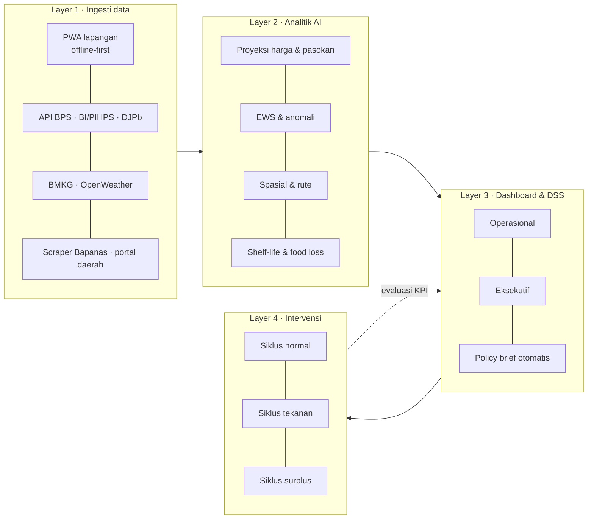
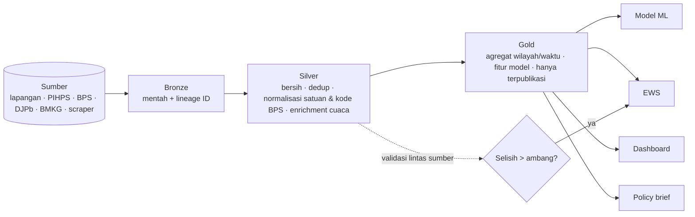
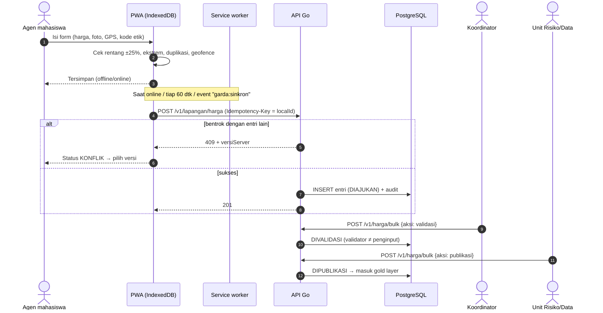
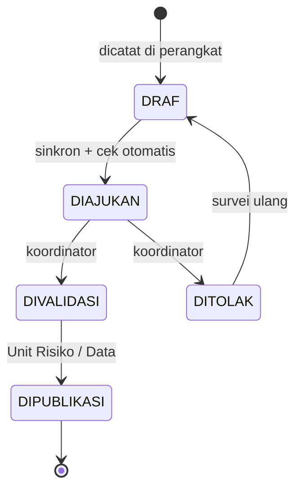
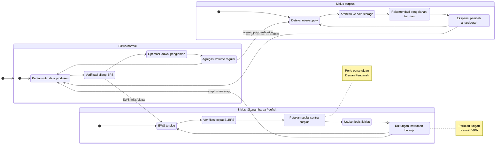
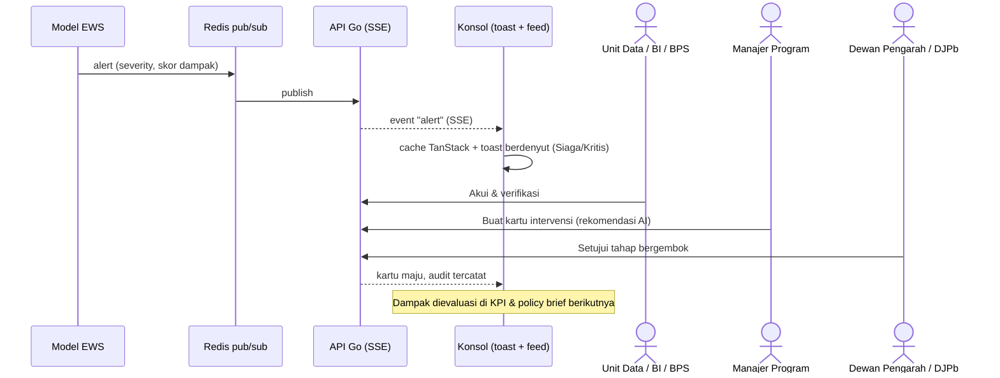
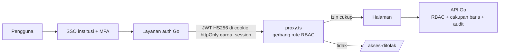

# Alur sistem & data — AI Garda Inflasi

Diagram Mermaid (dirender otomatis di GitHub/GitLab). Versi beranimasi ada di aplikasi: `/alur-sistem`.

## 1. Arsitektur 4 lapis

## 2. Pipeline medallion

## 3. Entri harga offline → publikasi

## 4. Tiga siklus intervensi

## 5. Dari peringatan ke keputusan

## 6. Autentikasi & otorisasi

