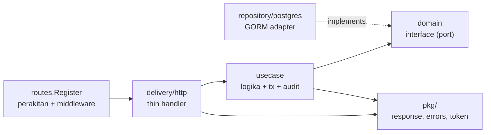
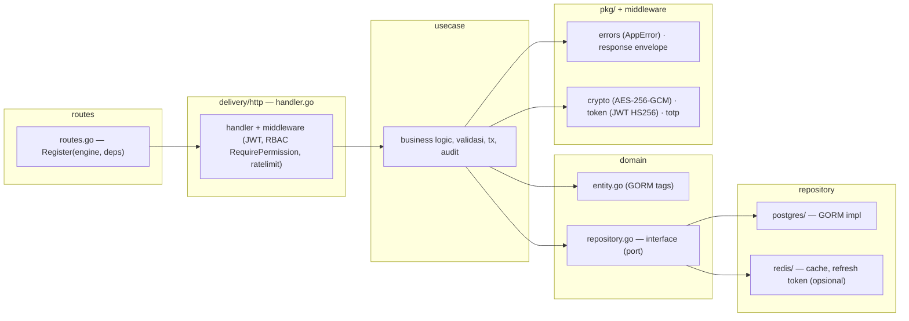
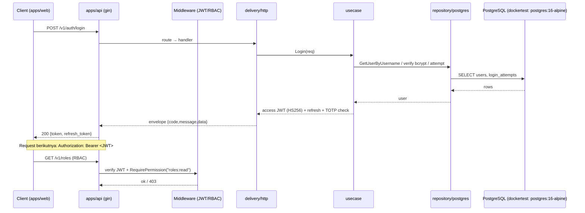
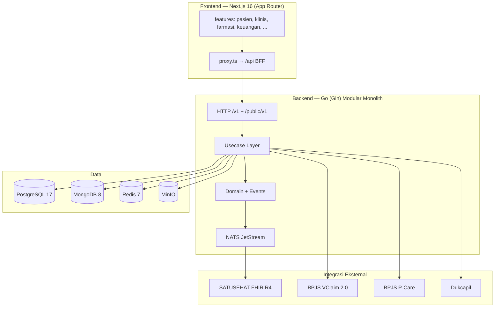

tech stack:
- Golang, Nextjs
- Postgre, MongoDB, redis
- Nats
- (Monorepo)
untuk membuat web toko online untuk umkm yang bisa checkout tapi dari sisi user tidak ada api langsung dari frontend, misal ada json pakai s3 (images static),
terus ketika checkout ada request ke backend untuk memproses pembayaran dan menyimpan data transaksi. Backend akan berkomunikasi dengan database Postgre untuk
menyimpan data produk, pesanan, dan pengguna, serta menggunakan MongoDB untuk menyimpan data yang lebih fleksibel seperti review produk atau log aktivitas pengguna.
Redis akan digunakan untuk caching data yang sering diakses agar performa lebih cepat. Nats akan digunakan sebagai message broker untuk mengatur komunikasi antar layanan
dalam arsitektur yang akan terhubung dengan database. Monorepo akan memudahkan pengelolaan kode dan dependensi antar layanan.
server akan ada 4: db 1, frontend 1, backend 1 dan reverse proxy 1
frontend akan menggunakan domain masing-masing dan tema yang dipilih oleh merchant, sedangkan backend akan menggunakan domain yang sama untuk semua merchant.
Reverse proxy akan mengatur routing antara frontend dan backend, serta mengelola SSL dan keamanan.

buatkan skema best practice untuk arsitektur web toko online ini dan berikut adalah skema best practice untuk arsitektur web toko online yang diusulkan:
1. **Frontend Layer**:
   - **Next.js**: Digunakan untuk membangun antarmuka pengguna yang responsif dan dinamis. Setiap merchant dapat memiliki domain dan tema yang berbeda, tetapi tetap menggunakan backend yang sama.
   - **Static Assets**: Gambar produk dan aset statis lainnya disimpan di layanan penyimpanan seperti S3 atau CDN untuk mengurangi beban server dan meningkatkan kecepatan akses.
2. **Backend Layer**:
   - **Golang**: Digunakan untuk membangun API backend yang cepat dan efisien. Backend akan menangani logika bisnis, pemrosesan pembayaran, dan komunikasi dengan database.
   - **Database**:
     - **PostgreSQL**: Digunakan untuk menyimpan data terstruktur seperti produk, pesanan, dan pengguna. PostgreSQL dipilih karena kemampuannya dalam menangani transaksi dan integritas data.
     - **MongoDB**: Digunakan untuk menyimpan data yang lebih fleksibel seperti review produk, log aktivitas pengguna, dan data yang tidak terstruktur. MongoDB dipilih karena kemampuannya dalam menangani data semi-terstruktur dan skema yang berubah- ubah.
   - **Redis**: Digunakan untuk caching data yang sering diakses, seperti daftar produk populer atau informasi pengguna, untuk meningkatkan performa dan mengurangi beban pada database utama.
3. **Message Broker Layer**:
   - **NATS**: Digunakan sebagai message broker untuk mengatur komunikasi antar layanan dalam arsitektur. NATS memungkinkan layanan backend untuk berkomunikasi secara asinkron, sehingga meningkatkan skalabilitas dan ketahanan sistem.
4. **Reverse Proxy Layer**:
   - **Reverse Proxy**: Digunakan untuk mengatur routing antara frontend dan backend, serta mengelola SSL dan keamanan. Reverse proxy akan memastikan bahwa permintaan dari pengguna diarahkan ke layanan yang tepat dan mengelola sertifikat SSL untuk semua domain merchant.
5. **Monorepo Repository**:
   - **Monorepo**: Digunakan untuk mengelola kode dan dependensi antar layanan dalam satu repositori. Monorepo memudahkan pengelolaan versi, integrasi, dan kolaborasi antar tim pengembang, serta memungkinkan penggunaan alat build dan deployment yang konsisten di seluruh layanan.
6. **Deployment and Scaling**:
   - **Server Setup**: Terdapat 4 server yang digunakan, yaitu:
     - **Frontend Server**: Menangani permintaan dari pengguna dan menyajikan antarmuka pengguna.
     - **Backend Server**: Menangani logika bisnis, pemrosesan pembayaran, dan komunikasi dengan database.
     - **Database Server**: Menyimpan data produk, pesanan, pengguna, dan data fleksibel lainnya.
     - **Reverse Proxy Server**:  Mengatur routing antara frontend dan backend, serta mengelola SSL dan keamanan.

# 1. Peta monorepo — 3 lapis kepemilikan

```
garda-inflasi/
├── apps/api/          # Go backend — modular monolith
├── apps/web/          # Next.js 16 frontend — feature-first + BFF
├── packages/
│   ├── contracts/     # openapi.yaml = SUMBER KEBENARAN (contract-first)
│   ├── ui/            # @store/ui — design system bersama (shadcn + Radix)
│   └── config/        # preset eslint/prettier/tailwind/tsconfig
├── db/                # SINGLE SOURCE OF TRUTH database (Goose migrations)
├── docker/            # Dockerfile api/seed/web + monitoring/
├── scripts/           # gen-module.sh, build.sh, e2e-up.sh
└── .agents/           # prompts/ (role pipeline) + plans/ (artefak) + skills/
```

**Aturan pembatas:** kode domain **tidak boleh** menyeberang app. FE tidak pernah memanggil backend langsung — selalu via BFF di `apps/web/src/app/api/**`.

---

# 2. Pattern Backend — Clean Architecture (Hexagonal) 4 layer

Pola: **Ports & Adapters**. `domain` = port, `repository/postgres` = adapter, `usecase` = pusat logika, `delivery/http` = adapter masuk.

```
apps/api/internal/auth/          ← 1 modul = 1 folder (auth/RBAC/SSO/user) — 1:1 modul PRD
├── domain/
│   ├── entity.go                # struct + tag gorm:"column:..." + TableName()
│   └── repository.go            # INTERFACE (port) — usecase hanya kenal ini
├── dto/
│   ├── request.go               # binding:"required,min=8" (tag gin)
│   └── response.go              # JSON shape = mirror OpenAPI
├── usecase/                     # ★ business logic + tx + audit
│   ├── usecase.go               # wiring + Config + DefaultConfig
│   ├── auth_usecase.go, role_usecase.go, user_usecase.go, sso.go,
│   ├── blacklist.go, totp_replay.go, password_policy.go, backup_codes.go
│   └── mocks_test.go            # mock repository (hand-written)
├── repository/postgres/         # adapter keluaran (GORM)
│   ├── user_repo.go, role_repo.go, permission_repo.go, audit_repo.go,
│   └── integration_test.go      # dockertest postgres:16-alpine
├── delivery/http/               # adapter masukan (thin handler)
│   ├── handler.go               # bindJSON(), badRequestID(), metaFromContext()
│   ├── auth_handler.go, user_handler.go, role_handler.go, permission_handler.go
│   └── *_integration_test.go
├── middleware/                  # RequestID, Logger, Recovery, SecurityHeaders,
│   └── CORS, AccessLog, JWTAuth, RequirePasswordChanged, RateLimit, RBAC
└── routes/routes.go             # Register(engine, Options) — SATU titik perakitan

apps/api/pkg/                    # shared TEKNIS (bukan domain bisnis)
├── cache/  crypto/  database/  errors/  logger/  metrics/
└── observability/  response/  sso/  token/  totp/  trace/
```

## Dependency rule (satu arah, tidak boleh dibalik)



**Konsekuensi praktis:**
- Handler **tipis**: `bindJSON` → panggil usecase → `response.Success/Error`. Tidak ada logika bisnis di handler/routes.
- Usecase **tidak** `import gorm` — hanya interface → bisa di-unit-test tanpa DB (terbukti: coverage usecase 87–95%).
- Ganti DB = tulis adapter baru di `repository/`, `domain` dan `usecase` tidak berubah.

## Alur request

```
HTTP /v1  →  middleware chain (RequestID → Logger → Recovery → SecurityHeaders
             → CORS → AccessLog → JWTAuth → RequirePasswordChanged → RateLimit → RBAC)
          →  delivery/http handler (binding + validasi)
          →  usecase (validasi bisnis + transaksi + audit + enkripsi PHI)
          →  domain interface  →  repository/postgres (GORM)
Respons:  { "code": "200", "message": "...", "data": {...} }   ← pkg/response
```

## Konvensi kode backend

| Aspek | Aturan |
|---|---|
| Envelope | `{code, message, data}` **selalu**, via `pkg/response` |
| Error | `pkg/errors`: `BadRequest/Unauthorized/Forbidden/NotFound/Conflict/Internal(msg, errs...)` → `AppError{code, httpStatus}`; **detail internal tidak boleh bocor** |
| Naming | folder/file `snake_case`; DTO suffix `Request`/`Response`; usecase `VerbDomain` (`AssignRole`, `SetupTOTP`) |
| GORM | tag `column:` eksplisit; `TableName()` eksplisit; **preload eksplisit** (hindari Save-association implisit — pernah jadi defect 428C9) |
| Error wrapping | `fmt.Errorf("...: %w", err)` |
| Context | `context.Context` diteruskan; tidak ada `context.Background()` di request path |
| PHI | AES-256-GCM field-level di **usecase**; masking untuk role tak berwenang; audit `old_value/new_value` di-scrub |
| Rate limit | key ter-hash (`RATE_LIMIT_HASH_SALT`) + fail-open; default dari `Options` (0 → default CTO) |
| Opsi modul | pola **functional options struct** `routes.Options{...}` dengan method `loginRateLimit()`, `securityHeaderOptions()` untuk default terpusat |
| Migrasi | `db/migrations/{NNN}_{table}.sql` + `-- +goose Up/Down` — **di root, bukan di dalam app** |


# Arsitektur Monorepo — RME (Rekam Medis Elektronik)

> Diagram arsitektur & struktur monorepo RME.
> Referensi teknis lengkap: `.agents/skills/rme/references/architecture.md`.
> PRD: `docs/PRD-RME.md` · Dev cycle: `docs/dev-cycle-rme.md`.

## 1. Monorepo (High-Level)

```mermaid
flowchart TB
    subgraph ROOT["grada-inflasi/ — root monorepo"]
        direction LR
        GW["go.work — use ./apps/api"]
        WF["pnpm-workspace.yaml + turbo.json"]
        MK["Makefile — help/dev/test/build/gen-module"]
        ENV["env.example → .env — JWT_SECRET, AES_KEY, APP_ADDR, DATABASE_URL, SMTP_*, …"]
        CMP["compose.yaml — postgres+redis+nats+api (+web profile)"]
        CMPE["compose.e2e.yaml — integration/E2E"]
        DKR["docker/ — api.Dockerfile · web.Dockerfile · postgres/init.sql"]
        SCR["scripts/ — gen-module.sh · build.sh · e2e-up.sh"]
    end

    subgraph API["apps/api — Go backend (module github.com/your-org/rme-backend)"]
        direction TB
        CMD["cmd/"]
        CMD_API["cmd/api/main.go — entrypoint HTTP :8080"]
        CMD_SEED["cmd/seed/main.go — seeder (Fase Integrasi)"]
        DOCS["docs/swagger/ — docs.go, swagger.json/yaml"]
        INT["internal/"]
        AUTH["internal/auth/ — B16 (kanonik hexagonal)"]
        OTHERS["internal/{modules dari garda inflasi - yang tersedia pada frontend}/ — (scaffold gen-module)"]
        PKG["pkg/ — cache · crypto · errors · response · token · totp"]
    end

    subgraph WEB["apps/web — Next.js 16 (App Router)"]
        APP["src/app/ — halaman & route groups"]
        FEAT["src/features/{modul}/ — api.ts · types.ts · components · hooks"]
        LIB["src/lib/ — apiClient (Axios) · proxy.ts (BFF)"]
        HOOKS["src/hooks/ — TanStack Query"]
        STORES["src/stores/ — Zustand"]
    end

    subgraph PKGS["packages/"]
        CTR["contracts/ — openapi.yaml (sumber kebenaran)"]
        CTRG["generated/typescript + generated/go"]
        UI["ui/ — Storybook (atoms/molecules/organisms)"]
        CFG["config/ — eslint · prettier · tailwind · tsconfig"]
    end

    subgraph DB["db/ — SINGLE SOURCE OF TRUTH"]
        MIG["migrations/ — Goose 000001_*.sql … 000012_*.sql"]
        QRY["queries/ — sqlc → repository/postgres"]
        SD["seed/legacy/ — fixtures (anonim)"]
    end

    CMD_API --> AUTH
    AUTH --> INT
    CMD_API --> OTHERS
    CMD_API --> PKG
    CTR -->|openapi-typescript| FEAT
    CTR -->|oapi-codegen| CMD_API
    MIG --> AUTH
    QRY --> AUTH
    UI --> WEB
    CFG --> WEB
    PKG --> WEB
    API -->|"/v1 + envelope {code,message,data}"| WEB
    CMP --> API
    CMP --> WEB
```



## 2. Arsitektur per Modul Backend (Hexagonal / Clean)

Setiap modul di `apps/api/internal/{modul}/` mengikuti 4 layer + pendukung.
Contoh kanonik: `internal/auth`.



> **Aliran request:** `routes → delivery/http (handler) → usecase → domain (interface)
> → repository (postgres/redis)`; respons keluar selalu envelope
> `{ "code", "message", "data" }`.

## 3. Alur Request — Contoh (Auth B16)



# Analisis Fitur Auth RME — Comprehensive Blueprint

> **Proyek:** Ada Teman — Monorepo `adateman/`
> **Modul:** Keamanan, Audit & RBAC
> **Status:** ✅ Selesai (Fase 0) — Dokumentasi untuk replikasi/porting
> **Total cakupan:** ~18.000+ baris Go backend + ~5.000+ baris TypeScript frontend + 14 migrasi SQL + 60+ file test

---

## 📋 Daftar Isi

1. [Ringkasan Arsitektur](#1-ringkasan-arsitektur)
2. [Fitur Backend (Go) — Detail Lengkap](#2-fitur-backend-go--detail-lengkap)
3. [Fitur Frontend (Next.js 16) — Detail Lengkap](#3-fitur-frontend-nextjs-16--detail-lengkap)
4. [Database Schema](#4-database-schema)
5. [API Contract (OpenAPI)](#5-api-contract-openapi)
6. [Security Implementation — Menyeluruh](#6-security-implementation--menyeluruh)
7. [Test Coverage](#7-test-coverage)
8. [Prompt untuk Implementasi Ulang](#8-prompt-untuk-implementasi-ulang)

---

## 1. Ringkasan Arsitektur

### Stack
| Layer | Teknologi |
|-------|-----------|
| Backend | Go, Gin, GORM, Hexagonal/Clean Architecture |
| Frontend | Next.js 16 (App Router), TypeScript, TanStack Query, Zustand, Tailwind + shadcn/ui |
| Database | PostgreSQL 16/17 (via Goose migrations) |
| Cache | In-memory (`pkg/cache`) / Redis 7 |
| Contract | OpenAPI 3.0.3 → `openapi-typescript` (FE) / `oapi-codegen` (BE) |
| Auth | JWT HS256, TOTP (RFC 6238), bcrypt cost 12, AES-256-GCM |
| SSO | Google OIDC + PKCE S256 |
| Test | testify (unit), dockertest (integration), Playwright (E2E) |

### Struktur Backend (per modul — hexagonal)
```
internal/auth/
├── domain/           # entity.go (GORM), repository.go (interface)
├── dto/              # request.go, response.go (binding tags)
├── usecase/          # *_usecase.go (business logic)
├── delivery/http/    # handler.go (tipis: binding → usecase → envelope)
├── middleware/       # auth.go (JWT), rbac.go (RequirePermission), ratelimit.go, security_headers.go
├── routes/           # routes.go — Register(engine, deps)
└── repository/postgres/  # *_repo.go (GORM implementation)
```

### Struktur Frontend (per fitur)
```
src/
├── app/(auth)/login/         # Halaman login
├── app/(auth)/forgot-password/
├── app/(auth)/reset-password/
├── app/(auth)/ganti-sandi-wajib/
├── app/(dashboard)/profil/   # Halaman profil
├── app/(dashboard)/superadmin/  # User, Role, Permission management
├── app/api/auth/             # BFF route handlers (14 endpoints)
├── features/auth/            # api.ts, types.ts, hooks/, components/
├── lib/                      # apiClient, proxy, csrf, rate-limit, errors, cookies, security-headers
├── stores/auth-store.ts      # Zustand store
└── middleware.ts             # UX guard + CSRF bootstrap
```

---

## 2. Fitur Backend (Go) — Detail Lengkap

### 2.1 Domain Entities (`internal/auth/domain/entity.go`)

```go
// User — akun pengguna dengan field auth lengkap
type User struct {
    ID                int64          `gorm:"column:id;primaryKey;autoIncrement"`
    Username          string         `gorm:"column:username;uniqueIndex;size:50"`
    Email             string         `gorm:"column:email;uniqueIndex;size:255"`
    PasswordHash      string         `gorm:"column:password_hash;size:255"`
    FullName          string         `gorm:"column:full_name;size:150"`
    RoleID            int64          `gorm:"column:role_id;index"`
    Role              *Role          `gorm:"foreignKey:RoleID"`
    Status            string         `gorm:"column:status;size:20;default:active"` // active|inactive|locked
    TOTPSecret        string         `gorm:"column:totp_secret;size:100"`          // AES-256-GCM encrypted
    TOTPEnabled       bool           `gorm:"column:totp_enabled;default:false"`
    FailedAttempts    int            `gorm:"column:failed_attempts;default:0"`
    LockedUntil       *time.Time     `gorm:"column:locked_until"`
    LockedReason      string         `gorm:"column:locked_reason;size:40"`         // password|totp|admin|""
    MustChangePassword bool          `gorm:"column:must_change_password;default:false"`
    PasswordChangedAt *time.Time     `gorm:"column:password_changed_at"`
    LastLoginAt       *time.Time     `gorm:"column:last_login_at"`
    ExternalID        *string        `gorm:"column:external_id;size:255"`          // Google sub
    AuthProvider      string         `gorm:"column:auth_provider;size:20;default:password"` // password|google
    EmailVerified     bool           `gorm:"column:email_verified;default:false"`
    CreatedAt         time.Time      `gorm:"column:created_at"`
    UpdatedAt         time.Time      `gorm:"column:updated_at"`
}

// Role — peran sistem (11 system roles + custom)
type Role struct {
    ID          int64           `gorm:"column:id;primaryKey;autoIncrement"`
    Name        string          `gorm:"column:name;uniqueIndex;size:50"`
    Slug        string          `gorm:"column:slug;uniqueIndex;size:50"`
    Description *string         `gorm:"column:description;size:255"`
    IsSystem    bool            `gorm:"column:is_system;default:false"`
    Permissions []Permission    `gorm:"many2many:role_permissions;"`
    CreatedAt   time.Time       `gorm:"column:created_at"`
    UpdatedAt   time.Time       `gorm:"column:updated_at"`
}

// Permission — izin {resource}:{action}
type Permission struct {
    ID          int64      `gorm:"column:id;primaryKey;autoIncrement"`
    Name        string     `gorm:"column:name;uniqueIndex;size:100"`
    Resource    string     `gorm:"column:resource;size:50;index"`
    Action      string     `gorm:"column:action;size:50"`
    Description *string    `gorm:"column:description;size:255"`
    IsSystem    bool       `gorm:"column:is_system;default:false"`
    CreatedAt   time.Time  `gorm:"column:created_at"`
    UpdatedAt   time.Time  `gorm:"column:updated_at"`
}

// RefreshToken — opaque token dengan rotasi & reuse detection
type RefreshToken struct {
    ID        int64      `gorm:"column:id;primaryKey;autoIncrement"`
    UserID    int64      `gorm:"column:user_id;index"`
    TokenHash string     `gorm:"column:token_hash;uniqueIndex;size:64"` // SHA-256 hex
    FamilyID  string     `gorm:"column:family_id;type:uuid;index"`
    Device    *string    `gorm:"column:device;size:255"`
    IP        *string    `gorm:"column:ip;size:45"`
    ExpiresAt time.Time  `gorm:"column:expires_at"`
    RevokedAt *time.Time `gorm:"column:revoked_at"`
    CreatedAt time.Time  `gorm:"column:created_at"`
}

// LoginAttempt — riwayat percobaan login (rate limiting & audit)
type LoginAttempt struct {
    ID            int64      `gorm:"column:id;primaryKey;autoIncrement"`
    UserID        *int64     `gorm:"column:user_id;index"` // NULL = unknown username
    IP            string     `gorm:"column:ip;size:45"`
    Success       bool       `gorm:"column:success"`
    FailureReason *string    `gorm:"column:failure_reason;size:40"` // password|totp|user_not_found
    AttemptedAt   time.Time  `gorm:"column:attempted_at"`
}

// AuditLog — jejak audit immutable
type AuditLog struct {
    ID         int64           `gorm:"column:id;primaryKey;autoIncrement"`
    ActorID    *int64          `gorm:"column:actor_id;index"` // NULL = anonymous
    Action     string          `gorm:"column:action;size:100"`
    Resource   string          `gorm:"column:resource;size:50"`
    ResourceID *string         `gorm:"column:resource_id;size:50"`
    OldValue   *string         `gorm:"column:old_value;type:jsonb"` // scrubbed
    NewValue   *string         `gorm:"column:new_value;type:jsonb"`
    IP         *string         `gorm:"column:ip;size:45"`
    UserAgent  *string         `gorm:"column:user_agent;size:255"`
    RequestID  *string         `gorm:"column:request_id;size:64"`
    CreatedAt  time.Time       `gorm:"column:created_at"`
}

// PasswordHistory — riwayat hash password (cegah reuse)
type PasswordHistory struct {
    ID           int64      `gorm:"column:id;primaryKey;autoIncrement"`
    UserID       int64      `gorm:"column:user_id;index"`
    PasswordHash string     `gorm:"column:password_hash;size:255"`
    CreatedAt    time.Time  `gorm:"column:created_at"`
}

// BackupCode — kode cadangan 2FA (disimpan sebagai salt:sha256hex)
type BackupCode struct {
    ID        int64       `gorm:"column:id;primaryKey;autoIncrement"`
    UserID    int64       `gorm:"column:user_id;index"`
    CodeHash  string      `gorm:"column:code_hash;size:255;uniqueIndex:uq_user_backup_codes_hash"`
    UsedAt    *time.Time  `gorm:"column:used_at"`
    CreatedAt time.Time   `gorm:"column:created_at"`
}
```

### 2.2 Repository Interface (`internal/auth/domain/repository.go`)

```go
type UserRepository interface {
    Create(ctx context.Context, user *User) error
    GetByID(ctx context.Context, id int64) (*User, error)
    GetByUsername(ctx context.Context, username string) (*User, error)
    GetByEmail(ctx context.Context, email string) (*User, error)
    GetByExternalID(ctx context.Context, externalID string) (*User, error)
    List(ctx context.Context, filter UserFilter) ([]User, int64, error)
    Update(ctx context.Context, user *User) error
    Delete(ctx context.Context, id int64) error
    UpdateLoginMeta(ctx context.Context, id int64, now time.Time) error
    IncrementFailedAttempts(ctx context.Context, id int64) error
    ResetFailedAttempts(ctx context.Context, id int64) error
    SetLockedUntil(ctx context.Context, id int64, until *time.Time, reason string) error
    SetMustChangePassword(ctx context.Context, id int64, must bool) error
    UpdatePassword(ctx context.Context, id int64, hash string) error
}

type RoleRepository interface {
    Create(ctx context.Context, role *Role) error
    GetByID(ctx context.Context, id int64) (*Role, error)
    GetBySlug(ctx context.Context, slug string) (*Role, error)
    List(ctx context.Context, filter RoleFilter) ([]Role, int64, error)
    Update(ctx context.Context, role *Role) error
    Delete(ctx context.Context, id int64) error
    SetPermissions(ctx context.Context, roleID int64, permissionIDs []int64) error
    GetPermissions(ctx context.Context, roleID int64) ([]Permission, error)
}

type PermissionRepository interface {
    Create(ctx context.Context, perm *Permission) error
    GetByID(ctx context.Context, id int64) (*Permission, error)
    GetByName(ctx context.Context, name string) (*Permission, error)
    List(ctx context.Context, filter PermissionFilter) ([]Permission, int64, error)
    Update(ctx context.Context, perm *Permission) error
    Delete(ctx context.Context, id int64) error
}

type RefreshTokenRepository interface {
    Create(ctx context.Context, token *RefreshToken) error
    GetByHash(ctx context.Context, hash string) (*RefreshToken, error)
    Revoke(ctx context.Context, id int64) error
    RevokeFamily(ctx context.Context, familyID string) error
    CleanupExpired(ctx context.Context) error
}

type LoginAttemptRepository interface {
    Create(ctx context.Context, attempt *LoginAttempt) error
    CountRecentByUser(ctx context.Context, userID int64, since time.Time) (int64, error)
    CountRecentByIP(ctx context.Context, ip string, since time.Time) (int64, error)
    CountRecentFailedByUser(ctx context.Context, userID int64, since time.Time) (int64, error)
}

type AuditLogRepository interface {
    Create(ctx context.Context, log *AuditLog) error
    List(ctx context.Context, filter AuditFilter) ([]AuditLog, int64, error)
}

type PasswordHistoryRepository interface {
    Create(ctx context.Context, history *PasswordHistory) error
    GetRecent(ctx context.Context, userID int64, limit int) ([]PasswordHistory, error)
}

type BackupCodeRepository interface {
    Create(ctx context.Context, codes []BackupCode) error
    GetUnusedByUser(ctx context.Context, userID int64) ([]BackupCode, error)
    MarkUsed(ctx context.Context, id int64) error
    DeleteByUser(ctx context.Context, userID int64) error
}
```

### 2.3 Usecase Layer — Semua Business Logic

#### AuthUsecase — Inti Autentikasi
| Method | Deskripsi | Security |
|--------|-----------|----------|
| `Login(ctx, req)` | Validasi kredensial + bcrypt verify + TOTP check + rate limit + lockout + audit | Anti-enumeration (pesan seragam), rate limit 5/menit/akun, lockout 5 gagal→15 menit, adaptive throttle |
| `RefreshToken(ctx, req)` | Rotasi refresh token + reuse detection (revoke seluruh family) | Opaque token, SHA-256 hash, family UUID, reuse = semua token family di-revoke |
| `Logout(ctx, userID, refreshToken)` | Revoke token + blacklist JTI | Blacklist via cache (TTL sesuai JWT expiry) |
| `ChangePassword(ctx, userID, oldPW, newPW)` | Verifikasi old + policy check + history check + rehash + revoke all sessions | Password policy (length, complexity, deny-list, leetspeak), history N terakhir, must_change_password di-reset |
| `ForgotPassword(ctx, email)` | Generate one-time reset token (TTL 15 menit) | Anti-enumeration (selalu return sukses), rate limit 3/jam/IP |
| `ResetPassword(ctx, token, password)` | Validasi token + policy + update password | Token one-time, TTL 15 menit, rate limit 5/jam/IP+token |
| `Me(ctx, userID)` | Profil + effective permissions | Role permissions ∪ grant overrides − deny overrides |

#### TOTPUsecase — Two-Factor Authentication
| Method | Deskripsi | Security |
|--------|-----------|----------|
| `SetupTOTP(ctx, userID)` | Generate secret (Base32) + QR URI + backup codes | Secret dienkripsi AES-256-GCM, backup codes = Crockford Base32 `XXXXX-XXXXX`, salt:sha256hex |
| `VerifyTOTP(ctx, userID, code)` | Validasi kode 6 digit + enable 2FA | Anti-replay (cache step number 90s), rate limit 10/menit |
| `GetBackupCodes(ctx, userID)` | Lihat kode cadangan (hanya sekali) | 409 jika sudah pernah generate |
| `RegenerateBackupCodes(ctx, userID)` | Generate ulang + revoke lama | Rate limit 5/jam |
| `UseBackupCode(ctx, username, password, code)` | Login via backup code | Validasi kredensial + consume code (salt:sha256hex verify) |

#### SSOUsecase — Single Sign-On Google
| Method | Deskripsi | Security |
|--------|-----------|----------|
| `Authorize(ctx)` | Generate Google OAuth2 URL + PKCE S256 | State + nonce + code_verifier disimpan di cache (TTL 10 menit) |
| `Callback(ctx, code, state)` | Exchange code → token → verify ID token → provision/link user | Verify JWT signature (JWKS), kid, iss, aud, exp, alg; anti-replay state; rate limit 5/menit/IP |

#### ProfileUsecase
| Method | Deskripsi | Security |
|--------|-----------|----------|
| `UpdateProfile(ctx, userID, req)` | Update nama/email | Email hanya untuk akun password (Google → 422), validasi duplikat |

#### WorkspaceUsecase
| Method | Deskripsi | Security |
|--------|-----------|----------|
| `ListWorkspaces(ctx, userID)` | Modul yang dapat diakses user | Dihitung dari effective permissions → mapping modul |

#### PasswordPolicyUsecase
| Method | Deskripsi | Security |
|--------|-----------|----------|
| `CheckPasswordPolicy(ctx, password, userID)` | Validasi kompleksitas | Min 8, max 72, huruf besar+kecil+angka+simbol, deny-list (common passwords + leetspeak), history N terakhir |
| `EnforcePasswordPolicy(ctx, password, userID)` | Policy + simpan history | Sama + simpan hash ke password_history |

#### BackupCodesUsecase
| Method | Deskripsi | Security |
|--------|-----------|----------|
| `GenerateBackupCodeSet()` | 10 kode Crockford Base32 | `XXXXX-XXXXX` format, salt:sha256hex hash |
| `SetupBackupCodes(ctx, userID)` | Generate + simpan | 10 kode, return sekali |
| `UseBackupCode(ctx, userID, code)` | Konsumsi kode | Verify hash, mark used_at |

#### BlacklistUsecase
| Method | Deskripsi | Security |
|--------|-----------|----------|
| `RevokeAccessToken(ctx, jti, exp)` | Blacklist JTI | Cache TTL sesuai JWT expiry |
| `IsRevoked(ctx, jti)` | Cek blacklist | Cache lookup |

#### TOTPReplayUsecase
| Method | Deskripsi | Security |
|--------|-----------|----------|
| `EnsureTOTPStepUnused(ctx, userID, step)` | Cek + mark step | Cache key `totp_replay:{userID}:{step}`, TTL 90 detik |
| `ClearTOTPSteps(ctx, userID)` | Bersihkan cache | Saat TOTP di-disable |

#### AuditUsecase
| Method | Deskripsi | Security |
|--------|-----------|----------|
| `Log(ctx, actorID, action, resource, resourceID, old, new, ip, userAgent, requestID)` | Catat audit | Old/new di-scrub (sensitive → `***`) |

#### RoleUsecase
| Method | Deskripsi | Security |
|--------|-----------|----------|
| `CreateRole(ctx, req)` | Buat role kustom | System role tidak bisa dibuat via API |
| `UpdateRole(ctx, id, req)` | Update role | System role: name/slug immutable |
| `DeleteRole(ctx, id)` | Hapus role | System role tidak bisa dihapus, cek tidak ada active users |
| `GetRole(ctx, id)` | Detail + permissions | — |
| `ListRoles(ctx, filter)` | List paginated | Search by name/slug |
| `AssignPermissions(ctx, roleID, permissionIDs)` | Full replace permissions | Audit trail |

#### PermissionUsecase
| Method | Deskripsi | Security |
|--------|-----------|----------|
| `CreatePermission(ctx, req)` | Buat permission | Format `{resource}:{action}` |
| `UpdatePermission(ctx, id, req)` | Update | System: description only |
| `DeletePermission(ctx, id)` | Hapus | System + assigned to role = ditolak |
| `GetPermission(ctx, id)` | Detail | — |
| `ListPermissions(ctx, filter)` | List paginated | Filter by resource |
| `CheckPermission(ctx, userID, permission)` | Cek izin | Role ∪ grant − deny |

#### UserUsecase
| Method | Deskripsi | Security |
|--------|-----------|----------|
| `ListUsers(ctx, filter)` | List paginated | Search, filter by role/status |
| `CreateUser(ctx, req)` | Buat user + assign role | Password policy enforced |
| `GetUser(ctx, id)` | Detail + effective permissions | — |
| `UpdateUser(ctx, id, req)` | Update nama/email/status | Status tidak bisa set ke locked langsung |
| `AssignRole(ctx, userID, roleID)` | Ganti role | Audit trail |
| `SetUserOverrides(ctx, userID, grantedIDs, deniedIDs)` | Override permission | Deny wins |
| `AdminResetPassword(ctx, userID, password)` | Reset oleh admin | Sets must_change_password=true, rate limit 10/jam/actor |
| `UnlockUser(ctx, userID)` | Buka lock | Rate limit 20/jam/actor |
| `DeactivateUser(ctx, userID)` | Soft-delete | Tidak bisa deactivate diri sendiri |

### 2.4 DTO Layer (`internal/auth/dto/`)

**Request DTOs:**
- `LoginRequest{ Username, Password, TOTPCode *string, RememberMe bool }`
- `RefreshRequest{ RefreshToken string }`
- `LogoutRequest{ RefreshToken string }`
- `ChangePasswordRequest{ OldPassword, NewPassword string }`
- `ForgotPasswordRequest{ Email string }`
- `ResetPasswordRequest{ Token, Password string }`
- `TotpVerifyRequest{ Code string }`
- `BackupCodeUseRequest{ Username, Password, Code string, Device *string }`
- `CreateRoleRequest{ Name, Slug, Description string, PermissionIDs []int64 }`
- `UpdateRoleRequest{ Name, Description string, PermissionIDs []int64 }`
- `AssignPermissionsRequest{ PermissionIDs []int64 }`
- `CreatePermissionRequest{ Name, Resource, Action, Description string }`
- `UpdatePermissionRequest{ Description string }`
- `CreateUserRequest{ Username, Email, FullName string, RoleID int64, Password string }`
- `UpdateUserRequest{ FullName, Email *string, Status *string }`
- `AssignRoleRequest{ RoleID int64 }`
- `SetUserOverridesRequest{ Granted, Denied []int64 }`
- `AdminResetPasswordRequest{ Password string }`
- `UpdateProfileRequest{ FullName, Email *string }`

**Response DTOs:**
- `LoginResponse{ AccessToken, RefreshToken string, ExpiresIn, RefreshExpiresIn int, Requires2FA, MustChangePassword bool, User UserProfile }`
- `RefreshResponse{ AccessToken, RefreshToken string, ExpiresIn, RefreshExpiresIn int }`
- `UserProfile{ ID, Username, Email, FullName, Role, Status, TOTPEnabled, MustChangePassword, LockedReason, AuthProvider, EmailVerified, Permissions, LastLoginAt, CreatedAt, UpdatedAt }`
- `TotpSetupResponse{ Secret, OTPAuthURI, ManualKey string, BackupCodes []string }`
- `BackupCodesResponse{ Codes []string, Remaining int, Warning string }`
- `SSOAuthorizeResponse{ AuthorizeURL string }`
- `RoleResponse{ ID, Name, Slug, Description, IsSystem, Permissions, CreatedAt, UpdatedAt }`
- `PermissionResponse{ ID, Name, Resource, Action, Description, IsSystem }`
- `UserResponse{ ID, Username, Email, FullName, Role, Status, TOTPEnabled, LastLoginAt, Permissions, CreatedAt, UpdatedAt }`
- `WorkspaceResponse{ Slug, Name, Description string, Order int }`

### 2.5 Handler Layer (`internal/auth/delivery/http/`)

**AuthHandler:**
- `POST /v1/auth/login` — Login (2FA-aware)
- `POST /v1/auth/refresh` — Rotate token
- `POST /v1/auth/logout` — Revoke session
- `POST /v1/auth/change-password` — Change password (revoke all)
- `POST /v1/auth/forgot-password` — Send reset email
- `POST /v1/auth/reset-password` — Reset with token
- `GET /v1/auth/me` — Current user profile
- `GET /v1/auth/sso/google/authorize` — SSO authorize URL
- `POST /v1/auth/sso/google/callback` — SSO callback

**TOTPHandler:**
- `POST /v1/auth/totp/setup` — Generate secret + QR + backup codes
- `POST /v1/auth/totp/verify` — Verify & enable
- `POST /v1/auth/totp/backup-codes` — Get backup codes (once)
- `POST /v1/auth/totp/backup-codes/regenerate` — Regenerate
- `POST /v1/auth/totp/backup-codes/use` — Login with backup code

**ProfileHandler:**
- `PATCH /v1/profile` — Update name/email

**WorkspaceHandler:**
- `GET /v1/workspaces` — List accessible modules

**RoleHandler:**
- `GET /v1/roles` — List (paginated)
- `POST /v1/roles` — Create
- `GET /v1/roles/{id}` — Detail
- `PUT /v1/roles/{id}` — Update
- `DELETE /v1/roles/{id}` — Delete
- `PUT /v1/roles/{id}/permissions` — Assign permissions

**PermissionHandler:**
- `GET /v1/permissions` — List (filterable)
- `POST /v1/permissions` — Create
- `GET /v1/permissions/{id}` — Detail
- `PUT /v1/permissions/{id}` — Update
- `DELETE /v1/permissions/{id}` — Delete

**UserHandler:**
- `GET /v1/users` — List (paginated, filterable)
- `POST /v1/users` — Create
- `GET /v1/users/{id}` — Detail
- `PUT /v1/users/{id}` — Update
- `DELETE /v1/users/{id}` — Soft-delete
- `PUT /v1/users/{id}/role` — Assign role
- `PUT /v1/users/{id}/permissions` — Set overrides
- `POST /v1/users/{id}/reset-password` — Admin reset
- `POST /v1/users/{id}/unlock` — Unlock

### 2.6 Middleware (`internal/auth/middleware/`)

| Middleware | Deskripsi | Detail |
|-----------|-----------|--------|
| `JWTAuth` | Validasi JWT access token | Verify HS256 signature, allowlist alg (blok none/RS*/HS384/etc), parse claims (userID, jti, role, permissions), set context |
| `RequirePermission(perm)` | RBAC gate | Cek permission dari JWT claims (role ∪ grant − deny), 403 jika tidak punya |
| `RateLimit` | Rate limiter | Per-IP dan per-akun, configurable limit + window, in-memory cache |
| `SecurityHeaders` | Response headers | X-Content-Type-Options, X-Frame-Options, Referrer-Policy, Permissions-Policy, COOP, CORP, CSP, HSTS (prod only), Cache-Control: no-store (auth endpoints) |
| `PasswordChangeGate` | Cek must_change_password | Blokir akses ke dashboard jika must_change_password=true, kecuali ke endpoint change-password |
| `RequestID` | Trace ID | Generate/forward X-Request-ID |
| `CORSMiddleware` | CORS | Allowlist origin, methods, headers |
| `Recovery` | Panic recovery | Gin recovery + log stack |
| `AccessLog` | Request logging | Structured log (method, path, status, duration, request_id) |

### 2.7 Routes (`internal/auth/routes/routes.go`)

```go
func Register(engine *gin.Engine, deps *Dependencies) {
    // Public
    public := engine.Group("/v1/auth")
    public.POST("/login", rateLimit.Login(), handler.Login)
    public.POST("/refresh", rateLimit.Refresh(), handler.Refresh)
    public.POST("/forgot-password", rateLimit.ForgotPassword(), handler.ForgotPassword)
    public.POST("/reset-password", rateLimit.ResetPassword(), handler.ResetPassword)
    public.POST("/totp/backup-codes/use", rateLimit.BackupCode(), handler.UseBackupCode)
    public.GET("/sso/google/authorize", rateLimit.SSO(), handler.SSOAuthorize)
    public.POST("/sso/google/callback", rateLimit.SSOCallback(), handler.SSOCallback)

    // Authenticated
    authed := engine.Group("/v1", middleware.JWTAuth())
    authed.POST("/auth/logout", handler.Logout)
    authed.POST("/auth/change-password", rateLimit.ChangePassword(), handler.ChangePassword)
    authed.GET("/auth/me", handler.Me)
    authed.POST("/auth/totp/setup", handler.SetupTOTP)
    authed.POST("/auth/totp/verify", rateLimit.TOTPVerify(), handler.VerifyTOTP)
    authed.POST("/auth/totp/backup-codes", rateLimit.BackupCodeGenerate(), handler.GetBackupCodes)
    authed.POST("/auth/totp/backup-codes/regenerate", rateLimit.BackupCodeRegenerate(), handler.RegenerateBackupCodes)
    authed.PATCH("/profile", handler.UpdateProfile)
    authed.GET("/workspaces", handler.ListWorkspaces)

    // RBAC-protected
    rbac := engine.Group("/v1", middleware.JWTAuth())
    rbac.GET("/roles", middleware.RequirePermission("role:read"), roleHandler.List)
    rbac.POST("/roles", middleware.RequirePermission("role:write"), roleHandler.Create)
    rbac.GET("/roles/:id", middleware.RequirePermission("role:read"), roleHandler.Get)
    rbac.PUT("/roles/:id", middleware.RequirePermission("role:write"), roleHandler.Update)
    rbac.DELETE("/roles/:id", middleware.RequirePermission("role:delete"), roleHandler.Delete)
    rbac.PUT("/roles/:id/permissions", middleware.RequirePermission("role:write"), roleHandler.AssignPermissions)
    rbac.GET("/permissions", middleware.RequirePermission("permission:read"), permHandler.List)
    rbac.POST("/permissions", middleware.RequirePermission("permission:write"), permHandler.Create)
    rbac.GET("/permissions/:id", middleware.RequirePermission("permission:read"), permHandler.Get)
    rbac.PUT("/permissions/:id", middleware.RequirePermission("permission:write"), permHandler.Update)
    rbac.DELETE("/permissions/:id", middleware.RequirePermission("permission:delete"), permHandler.Delete)
    rbac.GET("/users", middleware.RequirePermission("user:read"), userHandler.List)
    rbac.POST("/users", middleware.RequirePermission("user:write"), userHandler.Create)
    rbac.GET("/users/:id", middleware.RequirePermission("user:read"), userHandler.Get)
    rbac.PUT("/users/:id", middleware.RequirePermission("user:write"), userHandler.Update)
    rbac.DELETE("/users/:id", middleware.RequirePermission("user:delete"), userHandler.Delete)
    rbac.PUT("/users/:id/role", middleware.RequirePermission("user:write"), userHandler.AssignRole)
    rbac.PUT("/users/:id/permissions", middleware.RequirePermission("user:write"), userHandler.SetOverrides)
    rbac.POST("/users/:id/reset-password", rateLimit.AdminResetPassword(), middleware.RequirePermission("user:write"), userHandler.AdminResetPassword)
    rbac.POST("/users/:id/unlock", rateLimit.AdminUnlock(), middleware.RequirePermission("user:write"), userHandler.Unlock)
}
```

### 2.8 Shared Packages (`apps/api/pkg/`)

| Package | Fungsi |
|---------|--------|
| `pkg/crypto` | AES-256-GCM encrypt/decrypt, bcrypt hash/verify (cost 12), random bytes |
| `pkg/token` | JWT HS256 create/verify, allowlist alg, parse claims (userID, jti, role, permissions) |
| `pkg/totp` | RFC 6238 TOTP (HMAC-SHA1, 6-digit, 30s step), generate secret, validate code |
| `pkg/errors` | AppError (code + HTTP status + message), BadRequest/Unauthorized/Forbidden/NotFound/Conflict/Internal |
| `pkg/response` | Envelope `{ code, message, data }`, helper functions |
| `pkg/cache` | In-memory cache with TTL, thread-safe |
| `pkg/logger` | Structured JSON logging, sensitive data scrubbing, level filtering |
| `pkg/metrics` | Prometheus metrics, middleware, path label scrubbing |
| `pkg/trace` | OpenTelemetry setup, GORM plugin |

---

## 3. Fitur Frontend (Next.js 16) — Detail Lengkap

### 3.1 BFF Route Handlers (`apps/web/src/app/api/auth/`)

| Endpoint | Method | Fungsi |
|----------|--------|--------|
| `/api/auth/login` | POST | Forward ke `POST /v1/auth/login`, set httpOnly cookies (access + refresh + CSRF), return user profile |
| `/api/auth/refresh` | POST | Forward ke `POST /v1/auth/refresh`, rotate cookies, return new tokens |
| `/api/auth/refresh/logout` | POST | Forward ke `POST /v1/auth/logout`, clear all cookies |
| `/api/auth/logout` | POST | Shim — clear cookies (legacy) |
| `/api/auth/me` | GET | Forward ke `GET /v1/auth/me`, return user profile |
| `/api/auth/forgot-password` | POST | Forward ke `POST /v1/auth/forgot-password` |
| `/api/auth/reset-password` | POST | Forward ke `POST /v1/auth/reset-password` |
| `/api/auth/change-password` | POST | Forward ke `POST /v1/auth/change-password` |
| `/api/auth/sso/google/authorize` | GET | Forward ke `GET /v1/auth/sso/google/authorize`, redirect ke Google |
| `/api/auth/sso/google/callback` | GET | Forward ke `POST /v1/auth/sso/google/callback`, set cookies, redirect |
| `/api/auth/totp/setup` | POST | Forward ke `POST /v1/auth/totp/setup` |
| `/api/auth/totp/verify` | POST | Forward ke `POST /v1/auth/totp/verify` |
| `/api/auth/totp/backup-codes` | POST | Forward ke `POST /v1/auth/totp/backup-codes` |
| `/api/auth/totp/backup-codes/regenerate` | POST | Forward ke `POST /v1/auth/totp/backup-codes/regenerate` |

### 3.2 Client-Side API (`src/features/auth/api.ts`)

```typescript
// Semua fungsi memanggil BFF endpoint via apiClient (Axios)
login(input: LoginInput): Promise<LoginResult>
logout(): Promise<void>
fetchMe(): Promise<UserProfile>
changePassword(input: ChangePasswordInput): Promise<void>
forgotPassword(input: ForgotPasswordInput): Promise<void>
resetPassword(input: ResetPasswordInput): Promise<void>
setupTOTP(): Promise<TotpSetupResponse>
verifyTOTP(code: string): Promise<void>
getBackupCodes(): Promise<BackupCodesResponse>
regenerateBackupCodes(): Promise<BackupCodesResponse>
ssoAuthorize(): Promise<SSOAuthorizeResponse>
```

### 3.3 Hooks TanStack Query (`src/features/auth/hooks/`)

```typescript
useLogin()       → useMutation → onSuccess: set auth store + redirect
useLogout()      → useMutation → onSuccess: clear store + redirect
useMe()          → useQuery → staleTime: 5 min, retry: false
useChangePassword() → useMutation
```

### 3.4 Zustand Store (`src/stores/auth-store.ts`)

```typescript
interface AuthState {
  user: UserProfile | null
  status: 'loading' | 'authenticated' | 'unauthenticated'
  setUser(user: UserProfile): void
  clearUser(): void
  setStatus(status): void
}
```

### 3.5 Halaman & Komponen

**Login Page (`app/(auth)/login/page.tsx`):**
- 2-step form: kredensial → (jika TOTP enabled) TOTP code
- Google SSO button
- Forgot password link
- Anti-bruteforce: login attempt tracker (sessionStorage), exponential backoff
- Error: "Username atau kata sandi salah." (anti-enumeration)

**LoginForm Component:**
- Username + password fields
- TOTP code field (6 digit, muncul jika requires_2fa)
- Remember me checkbox
- Submit dengan loading state
- Error display (toast)

**TOTPForm Component:**
- 6-digit input (individual boxes)
- Auto-submit on complete
- Error handling

**GoogleLoginButton Component:**
- "Masuk dengan Google" button
- Loading state during redirect
- Error handling

**ForgotPassword Page + Form:**
- Email input
- Success message (always show, anti-enumeration)
- Link back to login

**ResetPassword Page + Form:**
- Token from URL params
- New password + confirm
- Password policy indicator
- Success → redirect to login

**ChangePasswordGate Component:**
- Wajib ganti password sebelum akses dashboard
- Old + new password + confirm
- Policy validation
- Logout option

**ChangePasswordForm Component:**
- Old password + new password + confirm
- Policy indicator
- Success → redirect

**Profile Page (`app/(dashboard)/profil/page.tsx`):**
- User info display
- Edit name/email
- TOTP enrollment dialog (QR → verify → backup codes)
- Login history
- Workspace list

### 3.6 Superadmin Pages

**User Management:**
- Table: No., Username, Email, Nama, Role, Status, TOTP, Login Terakhir, Aksi
- Create user dialog
- Edit user dialog
- Assign role dialog
- Permission overrides dialog
- Admin reset password dialog
- Unlock user button
- Bulk actions (deactivate)
- Search, filter by role/status, pagination

**Role Management:**
- Table: No., Nama, Slug, Deskripsi, Permission count, System badge, Aksi
- Create role dialog
- Edit role dialog (system: name/slug readonly)
- Permission matrix (checkboxes per resource group)
- Delete confirmation (system roles disabled)
- Search, pagination

**Permission Management:**
- Table: No., Nama, Resource, Action, Deskripsi, System badge, Aksi
- Create permission dialog
- Edit permission dialog (system: description only)
- Filter by resource
- Search, pagination

### 3.7 Shared Library (`src/lib/`)

| File | Fungsi |
|------|--------|
| `apiClient.ts` | Axios instance + interceptor: attach CSRF token, handle 401 → refresh queue, envelope parsing |
| `proxy.ts` | Server-side: `fetchBackend(url, options)`, cookie helpers (get/set/clear) |
| `cookies.ts` | Cookie names & attributes (single source of truth): `rme_access`, `rme_refresh`, `rme_csrf` |
| `csrf.ts` | CSRF double-submit: generate token, validate Origin/Referer against allowlist |
| `rate-limit.ts` | In-memory rate limiter (BFF): fixed window per hashed key, fail-open |
| `errors.ts` | Error normalization: anti-enumeration login errors, AppError parsing |
| `route-guard.ts` | `withGuard(handler, options)`: rate limit, origin check, CSRF validation |
| `security-headers.ts` | CSP & security headers for Next.js responses |
| `safe-redirect.ts` | Validate redirect URL (internal only, no open redirect) |
| `auth-notice.ts` | One-time auth notification via cookies (SSO errors, etc.) |
| `constants.ts` | Global constants |
| `contracts.ts` | Re-export OpenAPI types |
| `monitoring.ts` | GlitchTip/Sentry wrapper |

### 3.8 Middleware (`src/middleware.ts`)

- UX-only guard: cek keberadaan cookie (bukan validasi JWT)
- Bootstrap CSRF cookie jika belum ada
- Normalize legacy `?error=sso` → cookie notice
- CSP nonce per request
- Redirect unauthenticated → /login
- Redirect must_change_password → /ganti-sandi-wajib

### 3.9 Dashboard Layout (`app/(dashboard)/layout.tsx`)

- Session guard (fetch me on mount)
- DashboardShell with sidebar
- Topbar with user menu + logout
- Workspace-aware sidebar (dynamic modules)

---

## 4. Database Schema

### 4.1 Tables (14 migrasi)

| # | Tabel | Kolom Kunci | Indexes |
|---|-------|-------------|---------|
| 1 | `roles` | id (BIGINT PK), name (UNIQUE), slug (UNIQUE), is_system, description | — |
| 2 | `permissions` | id (BIGINT PK), name (UNIQUE), resource, action (UNIQUE res+act), is_system | `idx_permissions_resource` |
| 3 | `users` | id (BIGINT PK), username (UNIQUE), email (UNIQUE), password_hash, role_id (FK→roles), status (CHECK), totp_secret (encrypted), totp_enabled, failed_attempts, locked_until, locked_reason, must_change_password, password_changed_at, last_login_at, external_id (partial UNIQUE), auth_provider (CHECK), email_verified | `idx_users_role_id`, `uq_users_external_id` (partial), `idx_users_password_changed_at` |
| 4 | `refresh_tokens` | id (BIGINT PK), user_id (FK→users CASCADE), token_hash (UNIQUE, SHA-256), family_id (UUID), device, ip, expires_at, revoked_at | `idx_rt_user`, `idx_rt_family` |
| 5 | `login_attempts` | id (BIGINT PK), user_id (FK→users SET NULL), ip, success, failure_reason, attempted_at | `idx_la_user_time`, `idx_la_ip_time` |
| 6 | `audit_logs` | id (BIGINT PK), actor_id (FK→users SET NULL), action, resource, resource_id, old_value (JSONB), new_value (JSONB), ip, user_agent, request_id | `idx_al_actor_time`, `idx_al_resource`, `idx_al_created` |
| 7 | `role_permissions` | role_id (FK→roles CASCADE), permission_id (FK→permissions RESTRICT), PK (role_id, permission_id) | — |
| 8 | `user_permissions` | user_id (FK→users CASCADE), permission_id (FK→permissions RESTRICT), granted (BOOL), PK (user_id, permission_id) | — |
| 9 | `password_history` | id (BIGINT PK), user_id (FK→users CASCADE), password_hash, created_at | `idx_password_history_user` |
| 10 | `user_backup_codes` | id (BIGINT PK), user_id (FK→users CASCADE), code_hash (salt:sha256hex), used_at, created_at | `uq_user_backup_codes_hash`, `idx_user_backup_codes_user_unused` (partial) |

### 4.2 Seed Data

**11 System Roles:** superadmin, admin, dokter, perawat, apoteker, analis_lab, radiografer, kasir, admisi, klaim, auditor

**20 System Permissions (6 resource groups):**
- `auth:logout`, `auth:self`
- `user:read`, `user:write`, `user:delete`
- `role:read`, `role:write`, `role:delete`
- `permission:read`, `permission:write`, `permission:delete`
- `clinical:read`, `clinical:write`, `clinical:approve`
- `pharmacy:read`, `pharmacy:write`, `pharmacy:dispense`
- `finance:read`, `finance:write`, `finance:billing`

**1 Superadmin User:** username `superadmin@garda-inflasi.id`, kata sandi dev `Garda2024!` (lihat `db/migrations/000006_seed_data.sql`)

---

## 5. API Contract (OpenAPI)

### 5.1 Endpoints (34 total)

| Method | Path | Auth | Rate Limit | Deskripsi |
|--------|------|------|------------|-----------|
| POST | `/v1/auth/login` | Public | 5/min/akun | Login (2FA-aware, remember-me) |
| POST | `/v1/auth/refresh` | Public | 20/min | Rotate refresh token |
| POST | `/v1/auth/logout` | Bearer | — | Revoke session |
| POST | `/v1/auth/change-password` | Bearer | 10/hr/user | Change password, revoke all |
| POST | `/v1/auth/forgot-password` | Public | 3/hr/IP | Send reset email |
| POST | `/v1/auth/reset-password` | Public | 5/hr/IP+token | Reset with token |
| GET | `/v1/auth/me` | Bearer | — | Current user profile |
| GET | `/v1/auth/sso/google/authorize` | Public | 10/min/IP | SSO authorize URL |
| POST | `/v1/auth/sso/google/callback` | Public | 5/min/IP | SSO callback |
| POST | `/v1/auth/totp/setup` | Bearer | — | Generate TOTP secret |
| POST | `/v1/auth/totp/verify` | Bearer | 10/min | Verify & enable 2FA |
| POST | `/v1/auth/totp/backup-codes` | Bearer | 3/day | Get backup codes |
| POST | `/v1/auth/totp/backup-codes/regenerate` | Bearer | 5/hr | Regenerate codes |
| POST | `/v1/auth/totp/backup-codes/use` | Public | 5/min/IP | Login with backup code |
| PATCH | `/v1/profile` | Bearer | — | Update profile |
| GET | `/v1/workspaces` | Bearer | — | List modules |
| GET | `/v1/roles` | Bearer+role:read | — | List roles |
| POST | `/v1/roles` | Bearer+role:write | — | Create role |
| GET | `/v1/roles/{id}` | Bearer+role:read | — | Role detail |
| PUT | `/v1/roles/{id}` | Bearer+role:write | — | Update role |
| DELETE | `/v1/roles/{id}` | Bearer+role:delete | — | Delete role |
| PUT | `/v1/roles/{id}/permissions` | Bearer+role:write | — | Assign permissions |
| GET | `/v1/permissions` | Bearer+permission:read | — | List permissions |
| POST | `/v1/permissions` | Bearer+permission:write | — | Create permission |
| GET | `/v1/permissions/{id}` | Bearer+permission:read | — | Permission detail |
| PUT | `/v1/permissions/{id}` | Bearer+permission:write | — | Update permission |
| DELETE | `/v1/permissions/{id}` | Bearer+permission:delete | — | Delete permission |
| GET | `/v1/users` | Bearer+user:read | — | List users |
| POST | `/v1/users` | Bearer+user:write | — | Create user |
| GET | `/v1/users/{id}` | Bearer+user:read | — | User detail |
| PUT | `/v1/users/{id}` | Bearer+user:write | — | Update user |
| DELETE | `/v1/users/{id}` | Bearer+user:delete | — | Soft-delete |
| PUT | `/v1/users/{id}/role` | Bearer+user:write | — | Assign role |
| PUT | `/v1/users/{id}/permissions` | Bearer+user:write | — | Set overrides |
| POST | `/v1/users/{id}/reset-password` | Bearer+user:write | 10/hr/actor | Admin reset password |
| POST | `/v1/users/{id}/unlock` | Bearer+user:write | 20/hr/actor | Unlock account |

### 5.2 Response Envelope

```json
{
  "code": "200",
  "message": "success",
  "data": { ... }
}
```

Error codes: `400` (BadRequest), `401` (Unauthorized), `403` (Forbidden), `404` (NotFound), `409` (Conflict), `422` (UnprocessableEntity — password policy), `429` (TooManyRequests), `500` (InternalServerError)

### 5.3 Security Headers (selalu ON)

- `X-Content-Type-Options: nosniff`
- `X-Frame-Options: DENY`
- `Referrer-Policy: strict-origin-when-cross-origin`
- `Permissions-Policy: camera=(), microphone=(), geolocation=()`
- `Cross-Origin-Opener-Policy: same-origin`
- `Cross-Origin-Resource-Policy: same-origin`
- `Content-Security-Policy: default-src 'self'`
- `Strict-Transport-Security: max-age=31536000; includeSubDomains` (production only)
- `Cache-Control: no-store` (pada `/v1/auth/*` dan `/v1/profile`)

---

## 6. Security Implementation — Menyeluruh

### 6.1 Authentication Security

| # | Mekanisme | Implementasi | Detail |
|---|-----------|-------------|--------|
| 1 | **JWT HS256** | `pkg/token` | Access token 15 menit, allowlist alg (hanya HS256), explicit block `none`/`RS*`/`HS384`/etc, jti untuk blacklist |
| 2 | **Refresh Token Opaque** | SHA-256 hash di DB | Rotasi setiap digunakan, family UUID untuk reuse detection, revoke seluruh family jika reuse terdeteksi |
| 3 | **bcrypt cost 12** | `pkg/crypto` | Password hash dengan cost 12 (~250ms per hash), salt otomatis |
| 4 | **TOTP 2FA** | RFC 6238, HMAC-SHA1, 6-digit, 30s step | Secret dienkripsi AES-256-GCM, anti-replay (cache step 90s), backup codes (Crockford Base32, salt:sha256hex) |
| 5 | **Brute-force Lockout** | 5 failed attempts → 15 menit lock | LockedReason: `password`/`totp`/`admin`, auto-unlock setelah expired, admin bisa unlock manual |
| 6 | **Adaptive Throttle** | Delay bertahap per failed attempt | 0ms → 500ms → 1s → 2s → 4s (exponential backoff) |
| 7 | **Anti-Enumeration** | Pesan error seragam | Login gagal: selalu "Username atau kata sandi salah." terlepas dari penyebab (user not found, wrong password, locked, dll) |
| 8 | **Rate Limiting** | Per-IP dan per-akun | Login: 5/menit/akun, Refresh: 20/menit, ForgotPassword: 3/jam/IP, ResetPassword: 5/jam/IP+token, SSO: 10/menit/IP, TOTP Verify: 10/menit, Backup Code: 5/menit/IP, ChangePassword: 10/jam/user, AdminReset: 10/jam/actor, AdminUnlock: 20/jam/actor |
| 9 | **Password Policy** | Length 8-72, complexity, deny-list, leetspeak, history | Huruf besar+kecil+angka+simbol, common passwords + variasi leetspeak diblokir, N history terakhir dicek |
| 10 | **Must Change Password** | Flag di user | Set saat admin reset password, redirect ke halaman ganti sandi wajib |
| 11 | **Password Expiry** | `password_changed_at` | Configurable PASSWORD_EXPIRY_DAYS (default 0 = nonaktif) |
| 12 | **Session Management** | Logout revoke all tokens | ChangePassword revoke semua session, admin reset set must_change_password |

### 6.2 Authorization Security (RBAC)

| # | Mekanisme | Implementasi | Detail |
|---|-----------|-------------|--------|
| 1 | **Role-Based Access Control** | `RequirePermission(perm)` middleware | 205+ route dilindungi, permission format `{resource}:{action}` |
| 2 | **11 System Roles** | Seed migration | Superadmin, Admin, Dokter, Perawat, Apoteker, Analis Lab, Radiografer, Kasir, Admisi, Klaim, Auditor |
| 3 | **System Role Protection** | `is_system` flag | Tidak bisa dihapus, name/slug tidak bisa diubah |
| 4 | **Permission Override** | `user_permissions` table | Grant/deny per-user, deny wins (override role grant) |
| 5 | **Effective Permissions** | Role ∪ grant − deny | Dihitung saat GET user detail dan JWT generation |
| 6 | **Privilege Escalation Protection** | Hierarki role | Superadmin tidak bisa di-assign oleh admin, admin tidak bisa edit superadmin |
| 7 | **Self-Deactivation Protection** | Cek userID | User tidak bisa deactivate diri sendiri |
| 8 | **IDOR Protection** | Ownership check | User hanya bisa akses resource milik sendiri (kecuali role dengan permission) |

### 6.3 Data Security

| # | Mekanisme | Implementasi | Detail |
|---|-----------|-------------|--------|
| 1 | **PHI Encryption** | AES-256-GCM field-level | TOTP secret dienkripsi di DB, dekripsi hanya saat digunakan |
| 2 | **Audit Trail** | `audit_logs` table | Semua aksi auth tercatat: siapa, kapan, aksi, resource, old/new value (sensitive di-scrub `***`) |
| 3 | **Login Attempt Logging** | `login_attempts` table | Semua percobaan login (sukses/gagal) dengan failure_reason |
| 4 | **Sensitive Data Scrubbing** | Logger + audit | Token, password, secret tidak pernah di-log; old/new value di-scrub |
| 5 | **Backup Code Hashing** | salt:sha256hex | Backup codes tidak pernah plaintext di DB, salt per code |

### 6.4 Transport Security

| # | Mekanisme | Implementasi | Detail |
|---|-----------|-------------|--------|
| 1 | **HTTP-only Cookies** | Access + Refresh token | Tidak bisa diakses JavaScript, Secure + SameSite=Lax |
| 2 | **Cookie Prefix** | `__Host-` (access/CSRF), `__Secure-` (refresh) | Binding ke domain + path |
| 3 | **CSRF Double-Submit** | Non-httpOnly CSRF cookie + `x-csrf-token` header | Origin/Referer verification against allowlist, fail-closed |
| 4 | **Security Headers** | Middleware | CSP, HSTS, XFO, XCTO, Referrer-Policy, Permissions-Policy, COOP, CORP |
| 5 | **Cache-Control: no-store** | Auth endpoints | Mencegah browser cache halaman/auth response |
| 6 | **CORS** | Allowlist origin | Hanya origin terdaftar yang diizinkan |

### 6.5 SSO Security

| # | Mekanisme | Implementasi | Detail |
|---|-----------|-------------|--------|
| 1 | **PKCE S256** | code_verifier + code_challenge | Mencegah authorization code interception |
| 2 | **State + Nonce** | Random state + nonce di cache (TTL 10 menit) | Anti-CSRF, anti-replay |
| 3 | **ID Token Verification** | JWKS endpoint | Verify signature (kid), iss, aud, exp, alg — block alg none |
| 4 | **Account Linking** | `external_id` + `auth_provider` | Partial unique index, prevent duplicate linking |
| 5 | **Email Verification** | `email_verified` flag | Google-verified email, password accounts perlu verifikasi |
| 6 | **Rate Limit SSO** | 10/min/IP authorize, 5/min/IP callback | Mencegah brute-force callback |

### 6.6 Frontend Security

| # | Mekanisme | Implementasi | Detail |
|---|-----------|-------------|--------|
| 1 | **BFF Pattern** | Next.js Route Handlers | Token tidak pernah ke browser JavaScript, hanya httpOnly cookies |
| 2 | **CSRF Protection** | Double-submit cookie + Origin/Referer | Setiap mutasi BFF mewajibkan CSRF token |
| 3 | **Rate Limiting (BFF)** | In-memory fixed window | Fail-open (clinical availability > blocking) |
| 4 | **Anti-Enumeration** | Error normalization | Login error selalu pesan seragam |
| 5 | **Anti-Bruteforce** | Login attempt tracker (sessionStorage) | Exponential backoff, batas maksimal percobaan |
| 6 | **Replay Queue** | 401 interceptor queue | Multiple parallel 401 hanya trigger 1 refresh |
| 7 | **Safe Redirect** | Internal URL validation | Mencegah open redirect |
| 8 | **CSP Nonce** | Per-request nonce | Middleware generate nonce untuk inline scripts |
| 9 | **Auth Notice** | Cookie-based one-time notification | SSO error tidak via URL param (mencegah log leakage) |
| 10 | **Middleware Guard** | Cookie existence check | UX-only, bukan security boundary |

---

## 7. Test Coverage

### 7.1 Backend Unit Tests (co-located, tanpa Docker)

| Package | File | Test Cases | Coverage |
|---------|------|-----------|----------|
| `usecase/auth_usecase_test.go` | Login, Refresh, Logout, ChangePassword, ForgotPassword, ResetPassword, TOTP, Me | ~30 | ≥90% |
| `usecase/sso_test.go` | SSOAuthorize, SSOCallback (provision, link, conflict, privileged guard) | ~15 | ≥90% |
| `usecase/auth_hardening_test.go` | Lockout, adaptive throttle, password expiry, TOTP anti-replay, ChangePassword history, AdminResetPassword, UnlockUser, MustChangePassword | ~20 | ≥90% |
| `usecase/backup_codes_test.go` | Primitives, generateBackupCodeSet, SetupBackupCodes, RegenerateBackupCodes, UseBackupCode | ~15 | ≥90% |
| `usecase/password_policy_test.go` | checkPasswordPolicy, complexity, deny-list, leetspeak, history, enforcePasswordPolicy | ~20 | ≥90% |
| `usecase/profile_test.go` | UpdateProfile (name, email, Google account, duplicate, spaces) | ~10 | ≥90% |
| `usecase/workspace_test.go` | ListWorkspaces (permission filtering) | ~5 | ≥90% |
| `usecase/role_usecase_test.go` | CreateRole, UpdateRole, DeleteRole, AssignPermissions, GetRole, ListRoles | ~20 | ≥90% |
| `usecase/user_usecase_test.go` | ListUsers, CreateUser, GetUser, UpdateUser, AssignRole, SetUserOverrides, AdminResetPassword, UnlockUser, DeactivateUser | ~25 | ≥90% |
| `usecase/permission_usecase_test.go` | CreatePermission, UpdatePermission, DeletePermission, GetPermission, ListPermissions, CheckPermission | ~15 | ≥90% |
| `usecase/role_authority_pentest_test.go` | Escalation blocked, subset delegation, superadmin takeover, dedupe | ~10 | ≥90% |
| `usecase/auto_unlock_test.go` | LoginLockoutExpired, LoginLockoutBelumKedaluwarsa, LoginLockedPermanen, LoginLockoutExpired_GagalPersisten | ~8 | ≥90% |
| `usecase/totp_replay_test.go` | ensureTOTPStepUnused, indexTOTPStep, clearTOTPSteps | ~6 | ≥90% |
| `usecase/error_paths_test.go` | All usecase error paths (repo errors, corrupt hash, cache errors, etc.) | ~20 | ≥90% |
| `usecase/blacklist_test.go` | RevokeAccessToken, revokeCurrentToken, Logout+ChangePassword blacklist | ~8 | ≥90% |
| `usecase/remember_me_test.go` | LoginRememberMeUsesRememberMeTTL, LoginDefaultUsesRefreshTTL, RefreshPreservesRememberMePolicy, RefreshRotationRoundsPolicyKeDetik | ~8 | ≥90% |
| `usecase/role_permission_extra_test.go` | Extra error paths for role/permission usecases | ~10 | ≥90% |
| `pkg/sso/sso_test.go` | OIDC server mock, AuthorizeURL params, PKCE, Exchange, verifyIDToken | ~15 | ≥90% |
| `pkg/crypto/crypto_pentest_test.go` | bcrypt cost 12, salt uniqueness, AES-256-GCM key length, round-trip, nonce, AEAD integrity | ~10 | ≥90% |
| `pkg/logger/*_test.go` | JSON output with scrub, level filtering, text format, ConfigFromEnv, context, ErrAttr, nested group scrub | ~15 | ≥90% |
| `pkg/metrics/metrics_test.go` | Default disabled, middleware no-op, enabled records, unknown path, PathLabel, scrubLabelPath | ~8 | ≥90% |
| `pkg/trace/*_test.go` | ConfigFromEnv, parseEndpoint, Init disabled/enabled offline, Shutdown nil-safe, SetGlobal nil-safe, SetupGORM | ~10 | ≥90% |

### 7.2 Backend Integration Tests (dockertest, `//go:build integration`)

| File | Test Cases | Fokus |
|------|-----------|-------|
| `handler_integration_test.go` | E2E RBAC (healthz, login, me, roles CRUD, permissions CRUD, users CRUD) | ~15 |
| `auth_security_qa_test.go` | Lockout per akun (password threshold, TOTP counts, auto-unlock, admin unlock, IP rotation) | ~10 |
| `auth_hardening_handler_test.go` | Security headers, must_change_password, TOTP setup+verify+anti-replay, login 2FA, regenerate backup codes, change password policy | ~12 |
| `auth_controls_pentest_test.go` | Refresh token rotation + reuse detection, anti-user-enumeration, no cookie session | ~8 |
| `rbac_pentest_test.go` | JWT attacks (alg none/HS384/foreign key/tampered/expired), escalation, IDOR, mass assignment, sensitive field leakage, SQL injection | ~15 |
| `ratelimit_pentest_test.go` | Login per-akun (5/menit), login per-IP, backup code per-IP, reset password per-IP, forgot password per-IP (3/jam) | ~8 |
| `user_handler_integration_test.go` | CRUD, RBAC dokter 403, escalation admin→superadmin 403, self-deactivate rejected | ~13 |
| `user_handler_pentest_test.go` | Hierarki aktor→target, self-escalation, takeover proof, race TOCTOU superadmin, mass assignment, SQL injection, enumeration, sensitive field leakage, audit trail, rate limit admin | ~20 |
| `feature05_integration_test.go` | Session TTL, SSO (PKCE S256, provision, link, email verification), Profile, Workspace | ~12 |
| `repository_integration_test.go` | User CRUD, Role SetPermissions, Permission Effective+Override, RefreshToken RevokeFamily, Audit+LoginAttempt, User List+Delete, SSO fields | ~15 |
| `migration_integration_test.go` | 000014 auth_hardening migration (columns, tables, indexes, constraints, backfill, idempotency, Down reversibility, legacy data safety) | ~10 |

### 7.3 Frontend Tests

| File | Type | Test Cases |
|------|------|-----------|
| `features/auth/api.test.ts` | Unit (vitest) | API function calls |
| `features/auth/hooks/auth-hooks.test.tsx` | Unit (vitest) | TanStack Query hooks |
| `features/auth/components/*.test.tsx` | Unit (vitest) | LoginForm, AuthCard, GoogleLoginButton, ForgotPasswordForm, ResetPasswordForm, ChangePasswordGate, ChangePasswordForm, TOTPForm |
| `features/auth/login-attempts.test.ts` | Unit (vitest) | Login attempt tracker |
| `lib/__tests__/*.test.ts` | Unit (vitest) | apiClient, auth-notice, cookies, csrf, errors, proxy, rate-limit, route-guard, safe-redirect |
| `stores/auth-store.test.ts` | Unit (vitest) | Zustand store |
| `middleware.test.ts` | Unit (vitest) | Next.js middleware |
| `app/api/auth/**/route.test.ts` | Unit (vitest) | BFF route handlers (login, TOTP setup/verify/backup-codes, SSO, route-origin) |
| `e2e/login.spec.ts` | E2E (Playwright) | Login flow (success, failure, 2FA) |
| `e2e/sso.spec.ts` | E2E (Playwright) | SSO Google (stub IdP, 10 scenarios) |

---

## 8. Prompt untuk Implementasi Ulang

Gunakan prompt di bawah sebagai **template untuk mengimplementasikan auth dari nol** pada proyek baru, atau untuk **memperbarui plan/prompt existing** pada proyek ini.

---

### Cara Penggunaan

1. **Untuk proyek baru:** Copy seluruh prompt ini, sesuaikan path dan nama modul, lalu jalankan per role (CTO → Tech Architect → SWE → QA → Playwright → Pentester)
2. **Untuk update plan/prompt existing:** Gunakan bagian "Feature Inventory" sebagai checklist untuk memverifikasi kelengkapan, lalu gunakan "Prompt Template" untuk membuat/memperbarui file prompt per role

---

### Prompt Template — Backend Auth (Per Role Pipeline)

#### CTO Prompt
```
Anda adalah CTO RME. Review arsitektur auth berikut dan berikan keputusan GO/NO-GO.

## Feature Inventory (wajib ada semua)
[Copy seluruh section 2.1-2.8 dari dokumen ini]

## Security Checklist (wajib)
[Copy seluruh section 6 dari dokumen ini]

## Database Schema
[Copy seluruh section 4 dari dokumen ini]

## API Contract
[Copy seluruh section 5 dari dokumen ini]

## Tugas:
1. Review kelengkapan fitur vs PRD B16
2. Review security architecture
3. Identifikasi gap
4. Berikan keputusan GO/NO-GO dengan kondisi
```

#### Tech Architect Prompt
```
Anda adalah Tech Architect RME. Desain arsitektur teknis auth berdasarkan CTO approval.

## Feature Inventory
[Copy seluruh section 2.1-2.8]

## Security Requirements
[Copy seluruh section 6]

## Database Schema
[Copy seluruh section 4]

## Tugas:
1. Desain entity relationship (10 tabel)
2. Desain API contract (34 endpoint)
3. Desain middleware chain (7 middleware)
4. Desain usecase layer (12 usecase)
5. Desain repository interface (7 repository)
6. Tentukan shared packages (8 packages)
7. Tentukan rate limit strategy
8. Tentukan test strategy (unit + integration + pentest)
```

#### Software Engineer Prompt
```
Anda adalah Software Engineer RME. Implementasikan auth backend berdasarkan Tech Architect design.

## Tech Design
[Copy output Tech Architect]

## Coding Conventions
- Go 1.23+, Gin, GORM, hexagonal architecture
- Response envelope: {code, message, data}
- Error: pkg/errors AppError
- Naming: snake_case file/folder, CamelCase struct
- Handler tipis: binding → usecase → envelope
- Repository interface di domain, impl di repository/postgres
- GORM tags + TableName() eksplisit
- PHI: AES-256-GCM encrypt di usecase
- JWT: pkg/token HS256, allowlist alg
- bcrypt cost 12

## Tugas:
1. Buat migrasi database (14 file SQL)
2. Buat domain entities + repository interfaces
3. Buat DTO request/response
4. Buat repository implementations (GORM)
5. Buat usecase implementations (12 usecase)
6. Buat handler implementations (6 handler)
7. Buat middleware implementations (7 middleware)
8. Buat route registration
9. Buat shared packages (crypto, token, totp, errors, response, cache)
10. Buat unit test (coverage ≥ 85%)
11. Update openapi.yaml
```

#### QA Prompt
```
Anda adalah QA Engineer RME. Verifikasi implementasi auth backend.

## Feature Inventory
[Copy seluruh section 2]

## Test Strategy
- Unit test: co-located, testify, mock repository, tanpa Docker
- Integration test: dockertest postgres:16-alpine, //go:build integration
- Coverage gate: usecase ≥ 85%

## Tugas QA:
1. Review unit test coverage (min 85%)
2. Test all usecase error paths
3. Test rate limiting (8+ rate limit scenarios)
4. Test lockout mechanism (password + TOTP)
5. Test refresh token rotation + reuse detection
6. Test password policy (complexity, deny-list, leetspeak, history)
7. Test TOTP anti-replay
8. Test backup codes (generate, use, regenerate)
9. Test SSO flow (authorize, callback, provision, link)
10. Test RBAC (11 roles, permission override, deny wins)
11. Test audit trail completeness
12. Test anti-enumeration
13. Berikan verdict GO/NO-GO
```

#### Pentester Prompt
```
Anda adalah Pentester RME. Audit keamanan auth backend.

## Security Checklist
[Copy seluruh section 6]

## Attack Vectors yang WAJIB diuji:
1. JWT: alg none, alg HS384, foreign key, tampered payload, expired
2. Brute-force: password threshold, TOTP threshold, auto-unlock, admin unlock
3. Rate limit bypass: IP rotation, concurrent requests
4. RBAC escalation: user→admin, admin→superadmin, self-escalation
5. IDOR: akses user lain, akses resource tanpa permission
6. Mass assignment: field yang tidak seharusnya bisa diubah
7. SQL injection: semua parameter string
8. Sensitive field leakage: password hash, TOTP secret, token di response
9. Refresh token: reuse detection, revoked token, expired token
10. SSO: state replay, code replay, forged ID token, account linking hijack
11. CSRF: missing token, wrong origin, wrong referer
12. Security headers: missing/misconfigured
13. Audit trail: completeness, integrity
14. Password policy bypass: weak password, common password, leetspeak
15. Race condition: TOCTOU pada role change + concurrent request

## Tugas:
1. Jalankan semua attack vectors
2. Dokumentasikan temuan (Critical/High/Medium/Low)
3. Verifikasi fix untuk setiap temuan
4. Berikan verdict PASS/FAIL
```

---

### Prompt Template — Frontend Auth (Per Role Pipeline)

#### CTO Prompt (Frontend)
```
Anda adalah CTO RME. Review arsitektur frontend auth.

## Feature Inventory
[Copy seluruh section 3]

## Security Requirements
[Copy seluruh section 6.6]

## Tugas:
1. Review BFF architecture
2. Review cookie security strategy
3. Review CSRF implementation
4. Review rate limiting strategy
5. Berikan keputusan GO/NO-GO
```

#### Tech Architect Prompt (Frontend)
```
Anda adalah Tech Architect RME. Desain frontend auth.

## Feature Inventory
[Copy seluruh section 3]

## Tugas:
1. Desain BFF route handlers (14 endpoints)
2. Desain page structure (6 pages)
3. Desain component tree (10+ components)
4. Desain state management (Zustand store)
5. Desain API client with interceptors
6. Desain CSRF protection flow
7. Desain cookie strategy (3 cookies)
8. Desain rate limiting at BFF
9. Desain error handling (anti-enumeration)
10. Desain TOTP enrollment flow (3-step)
11. Desain SSO flow (authorize → callback → redirect)
```

#### Software Engineer Prompt (Frontend)
```
Anda adalah Software Engineer RME. Implementasikan frontend auth.

## Tech Design
[Copy output Tech Architect]

## Conventions
- Next.js 16 App Router
- TypeScript, TanStack Query, Zustand
- Tailwind + shadcn/ui (soft & smooth)
- BFF pattern: Route Handlers → Go backend
- HttpOnly cookies (no localStorage)
- CSRF double-submit
- Anti-enumeration login errors

## Tugas:
1. Implement BFF route handlers (14 files)
2. Implement login page + 2-step form
3. Implement forgot/reset password pages
4. Implement change password gate
5. Implement profile page with TOTP enrollment
6. Implement superadmin pages (user, role, permission management)
7. Implement API client with interceptors
8. Implement CSRF protection
9. Implement rate limiting
10. Implement auth store (Zustand)
11. Implement middleware (UX guard)
12. Implement unit tests (vitest)
```

#### QA Prompt (Frontend)
```
Anda adalah QA Engineer RME. Verifikasi frontend auth.

## Tugas:
1. Test all BFF routes (14 endpoints)
2. Test login flow (success, failure, 2FA, lockout)
3. Test SSO flow (authorize, callback, error)
4. Test TOTP enrollment (setup, verify, backup codes)
5. Test password management (change, forgot, reset)
6. Test CSRF protection
7. Test rate limiting
8. Test anti-enumeration
9. Test cookie security
10. Test responsive design
11. Test accessibility (vitest-axe, 0 violation)
```

#### Playwright Prompt
```
Anda adalah Playwright Engineer RME. Buat E2E test untuk auth.

## Skenario Wajib:
1. Login sukses (kredensial valid → dashboard)
2. Login gagal (wrong password → error message)
3. Login dengan TOTP 2FA
4. Login dengan remember me
5. Login dengan backup code
6. SSO Google (stub IdP) — full flow
7. SSO Google — callback dengan error
8. SSO Google — akun sudah ter-link
9. Forgot password → reset password flow
10. Change password → logout → login with new password
11. Ganti sandi wajib (must_change_password)
12. Logout → cannot access dashboard
13. Session expired → redirect to login
14. TOTP enrollment (QR → verify → backup codes)
15. User management CRUD (superadmin)
16. Role management CRUD (superadmin)
17. Permission management (superadmin)
```

#### Pentester Prompt (Frontend)
```
Anda adalah Pentester RME. Audit keamanan frontend auth.

## Attack Vectors:
1. CSRF: missing token, expired token, wrong origin
2. Cookie: httpOnly missing, secure missing, sameSite misconfigured
3. Open redirect: manipulation of redirect URL
4. XSS: injection in login fields
5. Token leakage: URL params, referrer, console
6. Rate limit bypass: BFF rate limit testing
7. Anti-enumeration: error message consistency
8. Session fixation: cookie manipulation
9. Clickjacking: X-Frame-Options
10. Insecure direct object reference: user ID in URL
```

---

### Prompt Template — Update Existing Plan/Prompt

Gunakan template ini untuk **memperbarui file plan/prompt yang sudah ada** dengan menambahkan fitur yang terlewat:

```
## UPDATE: Auth Feature Gap Analysis

### Fitur yang SUDAH ada di plan/prompt:
[list fitur yang sudah tercakup]

### Fitur yang TERLEWAT (harus ditambahkan):
[list fitur dari dokumen analisis yang belum ada]

### Security Gap:
[list security mekanisme yang belum tercakup]

### Test Gap:
[list test scenario yang belum tercakup]

### Action Items:
1. [file] → tambah: [deskripsi perubahan]
2. [file] → tambah: [deskripsi perubahan]
...
```

---

### Quick Reference — Semua File yang Perlu Dibuat

#### Backend Files (~60 files)

```
db/migrations/
├── 000001_roles.sql
├── 000002_permissions.sql
├── 000003_users.sql
├── 000004_refresh_tokens.sql
├── 000005_login_attempts.sql
├── 000006_audit_logs.sql
├── 000007_role_permissions.sql
├── 000008_user_permissions.sql
├── 000009_seed_roles.sql
├── 000010_seed_permissions.sql
├── 000011_seed_superadmin.sql
├── 000012_permissions_timestamps.sql
├── 000013_users_sso.sql
└── 000014_auth_hardening.sql

apps/api/internal/auth/
├── domain/
│   ├── entity.go
│   └── repository.go
├── dto/
│   ├── request.go
│   └── response.go
├── usecase/
│   ├── auth_usecase.go
│   ├── sso.go
│   ├── profile.go
│   ├── workspace.go
│   ├── backup_codes.go
│   ├── blacklist.go
│   ├── password_policy.go
│   ├── totp_replay.go
│   ├── audit.go
│   ├── permission_usecase.go
│   ├── role_usecase.go
│   ├── user_usecase.go
│   ├── passwords_common.go
│   └── *_test.go (18 files)
├── delivery/http/
│   ├── auth_handler.go
│   ├── handler.go
│   ├── permission_handler.go
│   ├── role_handler.go
│   └── user_handler.go
├── middleware/
│   ├── middleware.go
│   ├── auth.go
│   ├── rbac.go
│   ├── ratelimit.go
│   ├── security_headers.go
│   ├── password_change.go
│   └── http.go
├── routes/
│   └── routes.go
└── repository/postgres/
    ├── user_repo.go
    ├── role_repo.go
    ├── permission_repo.go
    ├── refresh_token_repo.go
    ├── login_attempt_repo.go
    ├── audit_repo.go
    ├── backup_code_repo.go
    └── password_history_repo.go

apps/api/pkg/
├── crypto/
├── token/
├── totp/
├── errors/
├── response/
├── cache/
├── logger/
├── metrics/
└── trace/

apps/api/tests/integration/
├── doc.go
├── handler_integration_test.go
├── auth_security_qa_test.go
├── auth_hardening_handler_test.go
├── auth_controls_pentest_test.go
├── rbac_pentest_test.go
├── ratelimit_pentest_test.go
├── user_handler_integration_test.go
├── user_handler_pentest_test.go
├── user_handler_pentest_helpers_test.go
├── feature05_integration_test.go
├── feature05_helpers_test.go
├── repository_integration_test.go
└── migration_integration_test.go
```

#### Frontend Files (~50 files)

```
apps/web/src/
├── middleware.ts
├── providers.tsx
├── app/(auth)/login/page.tsx
├── app/(auth)/forgot-password/page.tsx
├── app/(auth)/reset-password/page.tsx
├── app/(auth)/ganti-sandi-wajib/page.tsx
├── app/(dashboard)/layout.tsx
├── app/(dashboard)/profil/page.tsx
├── app/(dashboard)/superadmin/layout.tsx
├── app/api/auth/
│   ├── login/route.ts
│   ├── refresh/route.ts
│   ├── me/route.ts
│   ├── logout/route.ts
│   ├── refresh/logout/route.ts
│   ├── forgot-password/route.ts
│   ├── reset-password/route.ts
│   ├── change-password/route.ts
│   ├── sso/google/authorize/route.ts
│   ├── sso/google/callback/route.ts
│   ├── totp/setup/route.ts
│   ├── totp/verify/route.ts
│   ├── totp/backup-codes/route.ts
│   └── totp/backup-codes/regenerate/route.ts
├── features/auth/
│   ├── api.ts
│   ├── types.ts
│   ├── constants.ts
│   ├── change-password-schema.ts
│   ├── login-attempts.ts
│   ├── hooks/
│   │   ├── use-login.ts
│   │   ├── use-logout.ts
│   │   ├── use-me.ts
│   │   └── use-change-password.ts
│   └── components/
│       ├── auth-card.tsx
│       ├── login-form.tsx
│       ├── google-login-button.tsx
│       ├── forgot-password-form.tsx
│       ├── reset-password-form.tsx
│       ├── change-password-gate.tsx
│       ├── change-password-form.tsx
│       └── totp-form.tsx
├── lib/
│   ├── apiClient.ts
│   ├── proxy.ts
│   ├── cookies.ts
│   ├── csrf.ts
│   ├── auth-notice.ts
│   ├── route-guard.ts
│   ├── rate-limit.ts
│   ├── errors.ts
│   ├── constants.ts
│   ├── contracts.ts
│   ├── safe-redirect.ts
│   ├── security-headers.ts
│   └── monitoring.ts
├── stores/
│   └── auth-store.ts
└── components/shell/
    ├── topbar.tsx
    └── command-palette.tsx
```

#### Contract Files

```
packages/contracts/
├── openapi.yaml              # 34 endpoint, 30+ schema
└── generated/typescript/
    └── openapi.d.ts          # auto-generated
```

Arsitektur Teknis

### 11.0 Struktur Monorepo

```
grada-inflasi/
├── apps/api/                  # Go backend (hexagonal) — module github.com/your-org/rme-backend
│   ├── cmd/{api,seed}/        #   entrypoint HTTP + seeder
│   ├── internal/{modul}/      #   satu folder per modul RME (B01–B18 + pendukung)
│   │   └── delivery/http · domain · dto · repository/{postgres,redis} · usecase · routes
│   │       (unit test co-located: foo.go + foo_test.go)
│   ├── tests/integration/     #   integration test LINTAS SISTEM (package integration,
│   │                          #     //go:build integration, dockertest postgres:16-alpine)
│   └── pkg/                   #   shared lintas-modul (cache, crypto, errors, response, token, totp)
├── apps/web/                  # Next.js 16 — src/app + src/features/{modul}/ + src/lib (BFF proxy)
├── packages/
│   ├── contracts/             #   openapi.yaml (sumber kebenaran) → generated/{typescript,go}
│   ├── ui/                    #   Storybook (design system soft & smooth)
│   └── config/                #   eslint/prettier/tailwind/tsconfig bersama
├── db/                        # SINGLE SOURCE OF TRUTH database
│   ├── migrations/            #   Goose: 000001_roles.sql … 000012_permissions_timestamps.sql
│   ├── queries/               #   sqlc → repository/postgres
│   └── seed/legacy/           #   data lama RS (anonim) untuk go-live
├── docker/                    # api.Dockerfile · web.Dockerfile · postgres/init.sql
├── scripts/                   # gen-module.sh · build.sh · e2e-up.sh
├── docs/                      # PRD-RME.md · dev-cycle-rme.md · PROGRESS.md · prompts.md
├── compose.yaml               # Postgres + Redis + NATS + API (+ web via profile)
├── compose.e2e.yaml           # environment integration/E2E
├── go.work                    # use ./apps/api
├── Makefile · pnpm-workspace.yaml · turbo.json
├── env.example                # TEMPLATE env root (backend Go + Docker) — `make setup/env`
├── .env                       # hasil salin lokal (git-ignored)
└── apps/web/env.local.example # TEMPLATE env frontend → apps/web/.env.local
```



### 11.1 Prinsip Arsitektur

| Aspek | Rekomendasi |
|-------|-------------|
| FE→BE | Pertahankan BFF (`proxy.ts` + `apiClient`), **pisahkan feature per modul klinis** |
| State FE | Tambah `stores/` untuk antrean, pasien aktif, cart billing |
| Integrasi | Pisahkan client: `satusehat_client`, `vclaim_client` (HMAC), `pcare_client` (HMAC), `dukcapil_client` |
| Signature | Reusable `pkg/integration/signature.go` untuk VClaim + PCare |
| Audit | `fhir_logs`, `pcare_logs`, tambah `vclaim_logs`, `satusehat_audit` |
| Retry | Retry queue terpusat (NATS JetStream) untuk semua integrasi |

### 11.2 Struktur Frontend (1:1 dengan 18 modul)

> Lokasi fisik: `apps/web/src/features/{modul}/` (dokumen FE lama menyebut `frontend/src/features/` — kini `apps/web`).

```
apps/web/src/features/
├── auth/          # login, RBAC, audit
├── [modul sesuai dengan yang sudah ada pada hasil slicing frontend next]
```

### 11.3 Standar UX Tabel Data (lintas modul, wajib)

> **Sumber:** `.agents/plans/frontend/11-table-ux-uplift.md` (plan 11) · desain teknis
> `.agents/plans/frontend/11-table-ux-tech-architect-design.md` · implementasi
> `.agents/plans/frontend/11-table-ux-swe-report.md`. Diturunkan dari tabel `role`,
> `permission`, `user`, dan `pasien`; **berlaku untuk seluruh 18 modul**.

** existing directory yang disesuaikand dengan pola monorepo di atas:

## Arsitektur Frontend — AI Garda Inflasi

### Ringkasan Arsitektur

```
4 LAPIS BLUEPRINT
┌─────────────────────────────────────────────────────────────┐
│  LAPIS 1: DATA (Scraping, API, Input Lapangan, Master)     │
│  LAPIS 2: ANALITIK AI (EWS, Prediksi/XAI, Spasial, Cold)  │
│  LAPIS 3: EKSEKUTIF (Dashboard, Policy Brief, KPI)         │
│  LAPIS 4: KEPUTUSAN (Intervensi Kanban)                    │
│  + TATA KELOLA (Pengguna, Audit, Alur Sistem)              │
└─────────────────────────────────────────────────────────────┘
```

### Pohon Rute Lengkap

```
app/
├── layout.tsx                          ← Root: font, kontur backdrop, Providers
├── providers.tsx                       ← QueryClient, Theme, Motion, Tooltip, Sonner
├── page.tsx                            ← Redirect ke beranda per role
├── manifest.ts                         ← PWA manifest "Garda Lapangan"
├── not-found.tsx                       ← 404 kustom
│
├── (auth)/                             ← Route group tanpa console shell
│   ├── masuk/
│   │   ├── page.tsx                    ← Server component (metadata)
│   │   └── masuk-form.tsx             ← Client: SSO + MFA
│   └── lupa-password/
│       └── page.tsx
│
├── (console)/                          ← Route group dengan ConsoleShell
│   ├── layout.tsx                      ← getSession → ConsoleShell
│   │
│   ├── eksekutif/                      ← LAPIS 3: Dashboard Dewan Pengarah
│   │   └── page.tsx                    → components/eksekutif/executive-dashboard.tsx
│   │       ├── inflation-hero.tsx      ← Koridor inflasi (yoy vs sasaran)
│   │       ├── food-balance.tsx        ← Neraca pangan
│   │       ├── fiscal-space.tsx        ← Ruang fiskal + instrumen
│   │       └── xai-panel.tsx           ← XAI per komoditas
│   │
│   ├── operasional/                    ← LAPIS 3: Dashboard Tim Pelaksana
│   │   └── page.tsx                    → components/dashboard/
│   │       ├── kpi-grid.tsx            ← 6 KPI countUp + sparkline
│   │       ├── price-heatmap.tsx       ← Heatmap harga kabupaten×komoditas
│   │       ├── ops-map.tsx             ← Peta operasional (Mapbox)
│   │       └── field-activity.tsx      ← Aktivitas lapangan real-time
│   │
│   ├── data/
│   │   └── harga/                      ← LAPIS 1: Validasi & publikasi
│   │       └── page.tsx                → components/harga/
│   │           ├── harga-table.tsx     ← DataTable + centang massal
│   │           └── validation-queue.tsx← Antrean validasi
│   │
│   ├── ews/                            ← LAPIS 2: Peringatan dini
│   │   └── page.tsx                    → components/ews/
│   │       ├── ews-page.tsx            ← Tabel alert + filter severity
│   │       ├── ews-live-feed.tsx       ← Feed real-time SSE
│   │       ├── ews-meta.tsx            ← Ambang & kanal notifikasi
│   │       └── ews-toast.tsx           ← Toast kustom Sonner
│   │
│   ├── prediksi/                       ← LAPIS 2: AI prediktif
│   │   └── page.tsx                    → components/prediksi/
│   │       ├── prediksi-page.tsx       ← Proyeksi semua komoditas
│   │       └── xai-panel.tsx           ← Explainable AI + simulasi
│   │
│   ├── peta/                           ← LAPIS 2: Spasial
│   │   └── page.tsx                    → components/spasial/
│   │       ├── peta-page.tsx           ← Mapbox surplus-defisit
│   │       └── rute-distribusi.tsx     ← Rute logistik
│   │
│   ├── cold-storage/                   ← LAPIS 2: Cold storage & food loss
│   │   └── page.tsx                    → components/cold-storage/cs-page.tsx
│   │
│   ├── intervensi/                     ← LAPIS 4: Kanban keputusan
│   │   └── page.tsx                    → components/intervensi/
│   │       ├── kanban-board.tsx        ← 3 kolom siklus (dnd-kit)
│   │       ├── kanban-column.tsx       ← Kolom per tahap
│   │       └── kanban-card.tsx         ← Kartu intervensi
│   │
│   ├── policy-brief/                   ← LAPIS 3: Generator brief
│   │   └── page.tsx                    → components/brief/brief-page.tsx
│   │
│   ├── kpi/                            ← Indikator kinerja
│   │   └── page.tsx                    → components/kpi/kpi-page.tsx
│   │
│   ├── sumber-data/                    ← LAPIS 1: Pipeline data
│   │   └── page.tsx                    → components/sumber/
│   │       └── sumber-page.tsx         ← Status scraper/API + mutu data
│   │
│   ├── master/                         ← LAPIS 1: Master data
│   │   ├── komoditas/
│   │   ├── wilayah/
│   │   └── pasar/
│   │
│   ├── pengguna/                       ← TATA KELOLA: RBAC
│   │   └── page.tsx                    → components/pengguna/
│   │
│   ├── audit/                          ← TATA KELOLA: Audit trail
│   │   └── page.tsx                    → components/audit/audit-page.tsx
│   │
│   └── alur-sistem/                    ← TATA KELOLA: Dokumentasi
│       └── page.tsx                    → components/alur/alur-page.tsx
│
├── lapangan/                           ← PWA offline-first
│   ├── layout.tsx                      ← FieldShell (nav bawah, sync indicator)
│   ├── input/
│   │   └── page.tsx                    ← Form harga + geofence + foto
│   ├── riwayat/
│   │   └── page.tsx                    ← Queue perangkat + status server
│   └── tugas/
│       └── page.tsx                    ← Tugas survei + progres
│
└── offline/
    └── page.tsx                        ← Fallback SW
```

### Lapisan Kode per Direktori

```
lib/                              ← Semua logika non-UI
├── api/
│   ├── client.ts                 ← fetch wrapper, ApiError, mockDelay
│   ├── endpoints.ts              ← Satu fungsi per endpoint API
│   └── mock.ts                   ← Data deterministik untuk development
│
├── auth/
│   ├── session.ts                ← Server: getSession() dari cookie
│   ├── session-context.tsx        ← Client: SessionProvider + useSession
│   └── resolve.ts                ← Tipe SessionUser
│
├── rbac/
│   ├── permissions.ts            ← 35 izin granular + matriks Role→Permission
│   ├── roles.ts                  ← 14 role + metadata (label, lapis, cakupan)
│   └── routes.ts                 ← Proteksi rute berbasis izin
│
├── data/
│   ├── types.ts                  ← Semua tipe data (EntriHarga, EwsAlert, dll)
│   ├── generators.ts             ← Generator data mock
│   ├── master.ts                 ← Data master (komoditas, wilayah, pasar)
│   ├── reference.ts              ← Data referensi statis
│   └── siklus.ts                 ← Logika siklus ekonomi
│
├── design/
│   └── tokens.ts                 ← Cermin JS dari CSS custom properties
│
├── motion/
│   └── presets.ts                ← Semua preset gerak (spring, variants)
│
├── offline/
│   ├── acuan.ts                  ← Data acuan untuk offline
│   ├── idb-storage.ts            ← IndexedDB wrapper (idb-keyval)
│   ├── sync-engine.ts            ← Engine sinkronisasi idempoten
│   └── use-online.ts             ← Hook status koneksi
│
├── query/
│   ├── keys.ts                   ← Query key factory (hierarkis)
│   └── hooks.ts                  ← useQuery + useMutation untuk semua data
│
├── stores/
│   ├── ui-store.ts               ← Zustand: sidebar, command palette, mobile nav
│   ├── ews-store.ts              ← Zustand: unread count, stream status
│   ├── field-queue-store.ts      ← Zustand: antrean offline lapangan
│   └── kanban-store.ts           ← Zustand: state drag-and-drop kanban
│
├── format.ts                     ← Format angka, tanggal, rupiah (id-ID)
├── nav.ts                        ← Struktur navigasi + activeNav()
├── utils.ts                      ← cn(), sleep()
└── csv.ts                        ← Ekspor CSV

components/
├── layout/
│   ├── console-shell.tsx         ← Cangkang konsol (sidebar + topbar + main)
│   ├── sidebar.tsx               ← Sidebar kaca + NavList + badges
│   ├── topbar.tsx                ← Topbar + search + EWS bell + user menu
│   ├── brand-mark.tsx            ← Logo/merk
│   └── role-switcher.tsx         ← Switcher peran (dev)
│
├── garda/                        ← Primitif tampilan
│   ├── glass-card.tsx            ← Kartu kaca dengan variant interactive
│   ├── page-header.tsx           ← Header halaman konsisten
│   ├── segmented.tsx             ← Tab/pill dengan layoutId
│   ├── status-badge.tsx          ← Badge status (tone-aware)
│   ├── komoditas-icon.tsx        ← Ikon komoditas
│   ├── kontur-backdrop.tsx       ← Latar kontur topografi
│   ├── shimmer.tsx               ← Skeleton loading
│   └── spring-button.tsx         ← Tombol dengan spring animation
│
├── ui/                           ← shadcn/ui (Radix primitives)
│   ├── button.tsx, badge.tsx, input.tsx, select.tsx, ...
│   ├── dialog.tsx, sheet.tsx, popover.tsx, dropdown-menu.tsx
│   ├── tabs.tsx, checkbox.tsx, tooltip.tsx, avatar.tsx
│   ├── command.tsx               ← cmdk untuk command palette
│   ├── alert-dialog.tsx          ← Konfirmasi destruktif
│   ├── separator.tsx, label.tsx, progress.tsx, textarea.tsx
│   └── data-table.tsx            ← DataTable universal
│
├── data-table/
│   ├── data-table.tsx            ← Tabel dengan centang, sort, filter
│   └── bulk-action-bar.tsx       ← Bilah aksi massal (AnimatePresence)
│
├── dashboard/
│   ├── kpi-card.tsx              ← Kartu KPI dengan countUp + sparkline
│   ├── kpi-grid.tsx              ← Grid 6 KPI
│   ├── price-heatmap.tsx         ← Heatmap harga
│   ├── ops-map.tsx               ← Peta Mapbox
│   └── field-activity.tsx        ← Aktivitas lapangan
│
├── eksekutif/
│   ├── executive-dashboard.tsx   ← Dashboard eksekutif
│   ├── inflation-hero.tsx        ← Hero koridor inflasi
│   ├── food-balance.tsx          ← Neraca pangan
│   ├── fiscal-space.tsx          ← Ruang fiskal
│   ├── xai-panel.tsx             ← Explainable AI
│   └── exec-side.tsx             ← Side panel eksekutif
│
├── ews/
│   ├── ews-page.tsx              ← Halaman EWS
│   ├── ews-live-feed.tsx         ← Feed real-time
│   ├── ews-meta.tsx              ← Metadata ambang
│   ├── ews-toast.tsx             ← Toast notifikasi
│   └── use-ews-stream.ts         ← Hook SSE stream
│
├── charts/
│   ├── trend-chart.tsx           ← Grafik tren (Recharts)
│   └── glass-tooltip.tsx         ← Tooltip kaca untuk Recharts
│
├── intervensi/
│   ├── kanban-board.tsx          ← Board drag-and-drop
│   ├── kanban-column.tsx         ← Kolom kanban
│   └── kanban-card.tsx           ← Kartu intervensi
│
├── lapangan/
│   ├── field-shell.tsx           ← Cangkang PWA (nav bawah)
│   └── offline-indicator.tsx     ← Indikator sinkronisasi
│
├── command/
│   └── command-palette.tsx       ← ⌘K palette (cmdk)
│
├── motion/
│   ├── pulse-ring.tsx            ← Cincin denyut EWS
│   └── count-up.tsx              ← Animasi angka
│
├── map/                          ← Komponen peta
├── master/                       ← Halaman master data
├── prediksi/                     ← Halaman prediksi
├── pengguna/                     ← Halaman pengguna
├── sumber/                       ← Halaman sumber data
├── spasial/                      ← Komponen spasial
├── alur/                         ← Diagram alur
├── audit/                        ← Halaman audit
├── brief/                        ← Halaman policy brief
├── cold-storage/                 ← Halaman cold storage
├── flow/                         ← Diagram alur sistem
└── harga/                        ← Halaman harga
```

### Aliran Data

```
USER ACTION
    �
